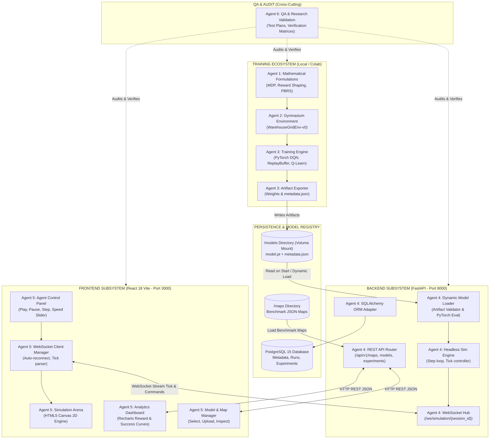

# ROBOPILOT — COMPONENT DIAGRAM SPECIFICATION
# SƠ ĐỒ THÀNH PHẦN HỆ THỐNG VÀ QUAN HỆ TƯƠNG TÁC

> **Tài liệu thuộc trách nhiệm:** Agent 0 (Project Orchestrator & System Architect)  
> **Trạng thái:** DRAFT / DESIGN PHASE  
> **Ngày ban hành:** 2026-10-29  

---

## 1. SƠ ĐỒ THÀNH PHẦN TỔNG THỂ (SYSTEM COMPONENT DIAGRAM)

Biểu đồ dưới đây mô tả mối quan hệ, ranh giới và giao thức kết nối giữa các khối thành phần trong toàn bộ hệ sinh thái RoboPilot V1:

---

## 2. CHI TIẾT TỪNG THÀNH PHẦN KỸ THUẬT

### 2.1. Nhóm thành phần Training (Agent 1, Agent 2, Agent 3)
- **`WarehouseGridEnv` (Gymnasium Core):** Cung cấp không gian trạng thái, ma trận bản đồ tĩnh và hàm chuyển trạng thái $s_{t+1} \sim \mathcal{P}(s_{t+1} \mid s_t, a_t)$.
- **`PBRS Engine` (Reward Shaping):** Tính toán phần thưởng tức thời $r_t$ và giá trị định hướng tiềm năng $F(s_t, s_{t+1}) = \gamma \Phi(s_{t+1}) - \Phi(s_t)$, loại bỏ hiện tượng đi lặp vòng tròn.
- **`PyTorch DQN Engine`:** Chứa mạng nơ-ron đánh giá $Q_\theta(s, a)$, mạng mục tiêu $Q_{\theta^-}(s, a)$, bộ nhớ đệm Replay Buffer với dung lượng $50,000$ mẫu, và bộ tối ưu hóa Adam.
- **`Model Artifact Exporter`:** Tự động tạo cấu trúc thư mục chứa tệp nhị phân (`model.pt`) và tệp siêu dữ liệu (`metadata.json`).

### 2.2. Nhóm thành phần Backend & Persistence (Agent 4)
- **`Dynamic Model Loader`:** Đọc tệp `metadata.json`, xác thực kiến trúc mạng (số layers, hidden units, observation dimension), sau đó nạp `model.pt` vào bộ nhớ RAM ở chế độ suy luận (`torch.no_grad()`).
- **`Headless Simulation Engine`:** Bản sao nhẹ của môi trường mô phỏng trên backend, tiếp nhận hành động từ model suy luận, cập nhật tọa độ robot và kiểm tra điều kiện kết thúc.
- **`WebSocket Connection Hub`:** Điều phối kết nối hai chiều với frontend, nhận lệnh điều khiển và phát luồng dữ liệu từng bước di chuyển (Tick DTO).
- **`PostgreSQL Database`:** Quản lý dữ liệu quan hệ gồm 4 thực thể chính: `maps`, `models`, `experiments`, `benchmark_runs`.

### 2.3. Nhóm thành phần Frontend (Agent 5)
- **`Canvas 2D Simulation Arena`:** Thành phần trung tâm vẽ bản đồ, lưới ô vuông, kệ hàng vật cản, robot kèm hướng nhìn, vệt đường đi đã đi qua (trajectory) và hiệu ứng va chạm tại tọa độ xảy ra sự cố.
- **`Agent Control Panel`:** Thanh điều khiển trực quan gồm các nút Play, Pause, Resume, Step (bước từng tick) và thanh trượt Ticks Per Second ($1 - 20$ Hz).
- **`Analytics Dashboard`:** Trực quan hóa các chỉ số thống kê từ các đợt huấn luyện và chạy thử nghiệm (Reward, Success Rate, Collision Rate, Steps to Goal).
- **`WebSocket Client Manager`:** Quản lý vòng đời kết nối socket, tự động bắt tay (handshake), lắng nghe dữ liệu và giải mã frame trạng thái để kích hoạt render trên Canvas.

### 2.4. Khối Đảm bảo Chất lượng & Độc lập Thẩm định (Agent 6)
- Đóng vai trò xuyên suốt (Cross-cutting concern), thực hiện rà soát độc lập các hợp đồng giao tiếp giữa các thành phần, giám sát rủi ro kỹ thuật và xây dựng kế hoạch kiểm thử tự động.
