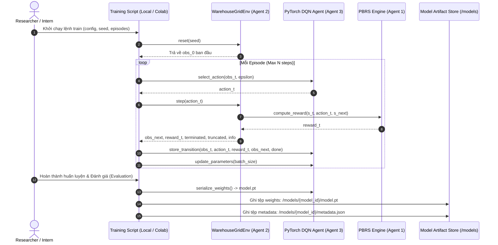
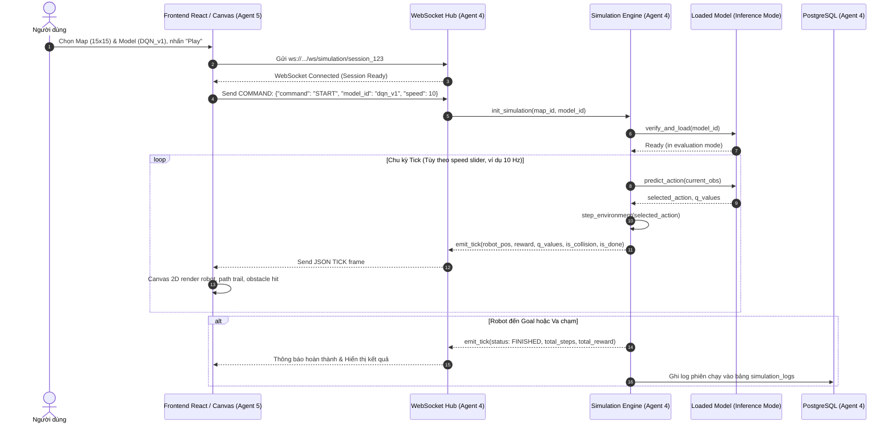
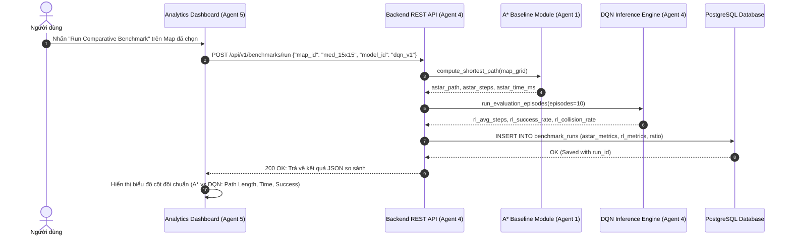

# ROBOPILOT — DATA FLOW & SEQUENCE SPECIFICATION
# LUỒNG DỮ LIỆU VÀ TRÌNH TỰ TƯƠNG TÁC HỆ THỐNG

> **Tài liệu thuộc trách nhiệm:** Agent 0 (Project Orchestrator & System Architect)  
> **Trạng thái:** DRAFT / DESIGN PHASE  
> **Ngày ban hành:** 2026-10-29  

---

## 1. TỔNG QUAN VÒNG ĐỜI DỮ LIỆU (DATA LIFECYCLE)

Dữ liệu trong RoboPilot di chuyển qua 3 luồng chính:
1. **Luồng Huấn luyện & Đóng gói (Training & Packaging Flow):** Trạng thái tương tác giữa Agent RL và Môi trường Gymnasium $\rightarrow$ Cập nhật trọng số $\rightarrow$ Xuất tệp nhị phân và `metadata.json`.
2. **Luồng Điều khiển & Mô phỏng Thời gian thực (Real-Time Simulation Flow):** Lệnh từ Frontend $\rightarrow$ WebSocket Backend $\rightarrow$ Nạp Model $\rightarrow$ Suy luận bước đi $\rightarrow$ Stream khung dữ liệu Tick $\rightarrow$ Vẽ Canvas 2D.
3. **Luồng Đối chuẩn & Phân tích (Benchmark & Analytics Flow):** Kết quả chạy A* và RL $\rightarrow$ REST API $\rightarrow$ PostgreSQL $\rightarrow$ Biểu đồ so sánh trên Dashboard.

---

## 2. CÁC BIỂU ĐỒ TRÌNH TỰ (SEQUENCE DIAGRAMS)

### 2.1. Luồng 1: Huấn luyện và Đóng gói Mô hình (Offline Training Pipeline)



---

### 2.2. Luồng 2: Mô phỏng Thời gian thực (Live Simulation Streaming via WebSocket)



---

### 2.3. Luồng 3: Đối chuẩn Thuật toán (A* vs RL Benchmark Comparison)



---

## 3. ĐẶC TẢ CẤU TRÚC DỮ LIỆU KHUNG TRUYỀN (DATA CONTRACT SCHEMAS)

### 3.1. Khung dữ liệu Tick thời gian thực (Server $\rightarrow$ Client)
```json
{
  "type": "SIM_TICK",
  "session_id": "sess_88294a",
  "step_index": 12,
  "data": {
    "robot_coordinates": {
      "x": 4,
      "y": 6,
      "heading": "RIGHT"
    },
    "goal_coordinates": {
      "x": 13,
      "y": 13
    },
    "action_taken": {
      "action_code": 3,
      "action_label": "RIGHT"
    },
    "q_values": [0.12, -0.45, 0.05, 0.89],
    "step_reward": -0.5,
    "cumulative_reward": 8.5,
    "flags": {
      "is_collision": false,
      "is_goal_reached": false,
      "is_timeout": false
    }
  }
}
```

### 3.2. Khung lệnh điều khiển mô phỏng (Client $\rightarrow$ Server)
```json
{
  "type": "SIM_COMMAND",
  "command": "SET_SPEED", // Các lệnh hỗ trợ: START, PAUSE, RESUME, RESET, STEP, SET_SPEED
  "payload": {
    "ticks_per_second": 15
  }
}
```

---

## 4. TÍNH BẢO MẬT VÀ TOÀN VẸN DỮ LIỆU
1. **Xác thực cấu trúc tệp:** Tệp `metadata.json` phải được kiểm tra schema nghiêm ngặt trước khi Backend cấp phát vùng nhớ nạp tệp `model.pt`.
2. **Kiểm tra biên an toàn (Safety Bounds):** Tọa độ robot nhận từ bất kỳ engine nào cũng được validate không vượt quá kích thước $W \times H$ của bản đồ.
3. **Session Isolation:** Mỗi kết nối WebSocket gắn với một `session_id` độc lập trên Backend, đảm bảo nhiều tab trình duyệt không làm nhiễu loạn trạng thái mô phỏng của nhau.
