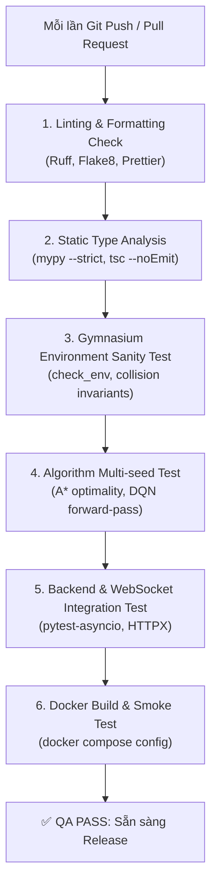

# ROBOPILOT — ENGINEERING & QUALITY ASSURANCE FRAMEWORK
# KHUNG LÀM VIỆC KỸ THUẬT: ĐẶT CHẤT LƯỢNG LÊN HÀNG ĐẦU & TỰ ĐỘNG HÓA KIỂM CHỨNG

> **Cơ quan ban hành:** Agent 0 (Project Orchestrator & System Architect) & Agent 6 (QA Specialist)  
> **Tuyên ngôn nguyên tắc:** *Không làm qua loa. Không chọn đường tắt dễ dãi. Mọi tác vụ đều phải được đặc tả, kiểm chứng toán học, viết kiểm thử tự động và thẩm định độc lập trước khi nghiệm thu.*  
> **Ngày ban hành:** 2026-10-30  

---

## 1. TRIẾT LÝ VÀ VĂN HÓA KỸ THUẬT (CORE PRINCIPLES)

Dự án RoboPilot tuân thủ **4 nguyên tắc sắt** trong mọi khâu phát triển:

```
               +-------------------------------------------------+
               |         NGUYÊN TẮC VĂN HÓA KỸ THUẬT             |
               +-------------------------------------------------+
               | 1. SPECIFICATION-FIRST: Có đặc tả mới bắt tay   |
               | 2. ZERO-TOLERANCE TO CORNER CUTTING: Không tắt  |
               | 3. AUTOMATED VERIFICATION: Mọi thứ tự động test |
               | 4. SCIENTIFIC HONESTY: Số liệu thực nghiệm thật  |
               +-------------------------------------------------+
```

1. **Specification-First (Hợp đồng trước, Code sau):** Không một dòng code nào được viết nếu chưa có tài liệu đặc tả Schema, Pre-conditions, Post-conditions và biên giới hạn rõ ràng.
2. **Zero-Tolerance to Shortcuts (Tuyệt đối không đi đường tắt):**
   - Nghiêm cấm "hardcode" tọa độ né vật cản trong logic AI để vượt qua bài test.
   - Nghiêm cấm tắt cảnh báo linter, bỏ qua type hints (`Any` vô tội vạ) hoặc comment-out test case bị fail.
   - Nghiêm cấm tự bịa đặt bảng số liệu hội tụ hay tỷ lệ thành công của RL.
3. **Automated Verification (Tự động hóa kiểm chứng):** Mọi module (Môi trường, Thuật toán, Backend, Frontend, Docker) đều phải có bộ kiểm thử tự động có thể chạy lại chỉ bằng 1 dòng lệnh.
4. **Independent Audit (Thẩm định chéo độc lập):** Agent viết code không được tự duyệt code của mình; **Agent 6 (QA)** là người độc lập thẩm định, chạy stress-test và cấp quyết định ký duyệt (Sign-off).

---

## 2. QUY TRÌNH 5 CỔNG KIỂM SOÁT CHẤT LƯỢNG (THE 5 QUALITY GATES)

Mỗi task kỹ thuật bắt buộc phải vượt qua tuần tự **5 Cổng Chất Lượng (Quality Gates)** trước khi được chuyển trạng thái sang `COMPLETED`:

```
+------------+       +------------+       +------------+       +------------+       +------------+
|   GATE 1   |  ==>  |   GATE 2   |  ==>  |   GATE 3   |  ==>  |   GATE 4   |  ==>  |   GATE 5   |
|   SPEC &   |       | TEST-SUITE |       | CLEAN IMPL |       | AUTO-CHECK |       |   QA AUDIT |
| CONTRACTS  |       |   DESIGN   |       | & TYPING   |       | & METRICS  |       |  SIGN-OFF  |
+------------+       +------------+       +------------+       +------------+       +------------+
```

### 🚪 CỔNG 1: ĐẶC TẢ VÀ HỢP ĐỒNG (SPECIFICATION GATE)
- Phải xác định rõ: **Input Schema**, **Output Schema**, **Trạng thái biên (Edge Cases)** và **Xử lý ngoại lệ (Exception Handling)**.
- Giao diện giữa các module phải tuân thủ nghiêm ngặt 11 Technical Contracts đã ban hành trong `SYSTEM_ARCHITECTURE.md`.
- *Người kiểm tra:* Agent 0 phê duyệt tính nhất quán kiến trúc.

### 🚪 CỔNG 2: THIẾT KẾ BỘ KIỂM THỬ TRƯỚC (TEST-DRIVEN DESIGN GATE)
- Viết sẵn các kịch bản kiểm thử (Test Cases) trước khi hoàn thiện logic:
  - Happy Path (Trường hợp tiêu chuẩn).
  - Boundary Cases (Điểm biên bản đồ, pin cạn $0\%$, robot bị vây kín bởi 4 bức tường).
  - Malformed Inputs (Tệp JSON hỏng, vector quan sát sai shape, nạp file weights không khớp architecture).
- *Người thực hiện:* Agent phụ trách phối hợp cùng Agent 6.

### 🚪 CỔNG 3: TRIỂN KHAI CHUẨN MỰC & ĐỊNH KIỂU NGHIÊM NGẶT (IMPLEMENTATION GATE)
- **Python (AI Core & Backend):**
  - Tuân thủ chuẩn PEP 8, kiểm tra bằng `ruff` hoặc `flake8`.
  - Ép kiểu dữ liệu nghiêm ngặt 100% bằng Python Type Hints (`mypy --strict`).
  - Mỗi hàm phải có Docstring chuẩn Google Style mô tả `Args`, `Returns`, `Raises`.
- **TypeScript (Frontend):**
  - Cấu hình TypeScript Strict Mode (`"strict": true` trong `tsconfig.json`).
  - Tuyệt đối không dùng kiểu `any`, phải định nghĩa Interfaces/Types cho mọi WebSocket payload và REST DTO.

### 🚪 CỔNG 4: TỰ ĐỘNG CHẠY KIỂM CHỨNG (AUTOMATED VERIFICATION GATE)
- Chạy toàn bộ test suite cục bộ thông qua công cụ CI tự động:
  - `pytest --cov=src` (Yêu cầu Code Coverage tối thiểu $\ge 85\%$).
  - Đối với Gymnasium Env: Phải vượt qua `gymnasium.utils.env_checker.check_env(env)`.
  - Đối với Backend: Test toàn bộ REST endpoints và WebSocket handshake bằng `httpx` & `pytest-asyncio`.
  - Đối với Docker: Chạy kiểm thử tự động khởi động các container và kiểm tra `healthcheck` status trong 30 giây.

### 🚪 CỔNG 5: THẨM ĐỊNH ĐỘC LẬP VÀ NGHIỆM THU (QA AUDIT & SIGN-OFF GATE)
- Agent 6 thực hiện các bài kiểm tra rủi ro chuyên sâu:
  - **Kiểm tra Reward Hacking:** Chạy 100 episodes không giới hạn bước, xác nhận robot không học hành vi đi lặp vòng tròn.
  - **Kiểm tra Đa hạt nhân (Multi-seed):** Huấn luyện trên ít nhất 3 random seeds khác nhau; kết quả báo cáo bắt buộc phải gồm $\text{Mean} \pm \text{Std}$.
  - **Kiểm tra Zero-shot:** Ném model đã huấn luyện vào bản đồ lạ để đo độ suy giảm hiệu năng thực tế.
- Nếu phát hiện bất kỳ dấu hiệu "ăn gian" hay lỗi tiềm ẩn, Agent 6 có quyền **VETO (Bác bỏ)** và yêu cầu làm lại từ Cổng 1.

---

## 3. ĐỊNH NGHĨA "HOÀN THÀNH" CHO TỪNG PHÂN HỆ (DEFINITION OF DONE - DoD)

Một nhiệm vụ chỉ được đánh dấu là `DONE` khi thỏa mãn đồng thời toàn bộ tiêu chuẩn sau:

### 3.1. Phân hệ Môi trường & Robotics (`ai_core/env`)
- [ ] Tuân thủ $100\%$ Gymnasium standard API (`reset`, `step`, `render`, `close`).
- [ ] Không có memory leak khi chạy liên tục 10,000 episodes.
- [ ] Logic va chạm $O(1)$ chính xác tuyệt đối: Robot không bao giờ đi xuyên qua kệ hàng hoặc ra ngoài biên bản đồ trong mọi tình huống.
- [ ] Đạt chuẩn `check_env()` của Gymnasium mà không có warning nào.

### 3.2. Phân hệ Thuật toán AI (`ai_core/algorithms`)
- [ ] Không gian quan sát độc lập với kích thước tuyệt đối của bản đồ (Hỗ trợ Generalization).
- [ ] Hàm thưởng thỏa mãn định lý Potential-based Reward Shaping (được chứng minh toán học).
- [ ] Target Network và Replay Buffer của PyTorch DQN được viết module hóa, có seed kiểm soát.
- [ ] Xuất tệp `metadata.json` đầy đủ thông tin: architecture, hyperparameters, normalization params, metrics.

### 3.3. Phân hệ Backend API (`src/backend`)
- [ ] Toàn bộ REST API có Pydantic schemas xác thực request/response.
- [ ] Swagger Docs (`/docs`) hiển thị đầy đủ mô tả, status codes (200, 400, 404, 500).
- [ ] WebSocket hub tự động dọn dẹp connection khi client ngắt kết nối (No zombie sessions).
- [ ] Tự động validate `metadata.json` trước khi nạp model vào RAM; trả lỗi rõ ràng nếu weights bị hỏng.

### 3.4. Phân hệ Frontend UI (`src/frontend`)
- [ ] Canvas 2D render mượt mà 60 FPS, không drop frame khi robot di chuyển liên tục.
- [ ] Tự động kết nối lại (Auto-reconnect) khi WebSocket bị ngắt quãng.
- [ ] Xử lý đầy đủ 4 trạng thái giao diện: `Loading`, `Error`, `Empty Data`, `Success`.
- [ ] Giao diện co giãn đáp ứng (Responsive) tốt trên màn hình máy tính phổ thông ($1366\times 768$ đến $1920\times 1080$).

### 3.5. Phân hệ DevOps & Đóng gói (`docker`)
- [ ] Khởi chạy toàn bộ hệ thống bằng đúng 1 lệnh duy nhất: `docker compose up --build`.
- [ ] Có healthcheck cho PostgreSQL, đảm bảo backend chỉ kết nối khi DB đã sẵn sàng nhận truy vấn.
- [ ] Volume mount thư mục `./models` và `./maps` hoạt động 2 chiều chính xác.

---

## 4. HỆ THỐNG KIỂM CHỨNG TỰ ĐỘNG HÓA (CI/CD PIPELINE)

Để đảm bảo chất lượng không phụ thuộc vào trí nhớ con người, hệ thống sẽ thiết lập **GitHub Actions Automated Pipeline** (`.github/workflows/verify.yml`):



---

## 5. NHẬT KÝ LỖI & BÀI HỌC KHOA HỌC (FAILURE & LEARNING LOG)

Dự án xem **thất bại và lỗi kỹ thuật là tài sản khoa học quý giá**:
- Mọi hiện tượng thuật toán không hội tụ, robot bị kẹt, hoặc reward hacking đều phải được ghi lại trong tài liệu `docs/FAILURE_ANALYSIS.md`.
- Trình bày rõ:
  1. *Hiện tượng xảy ra là gì?*
  2. *Nguyên nhân toán học / kỹ thuật gốc rễ (Root Cause)?*
  3. *Các phương án giải quyết đã thử nghiệm và kết quả đối chứng?*
- Đây chính là bằng chứng xác thực mạnh mẽ nhất cho năng lực R&D thực chiến khi trình bày với các chuyên gia và nhà tuyển dụng.
