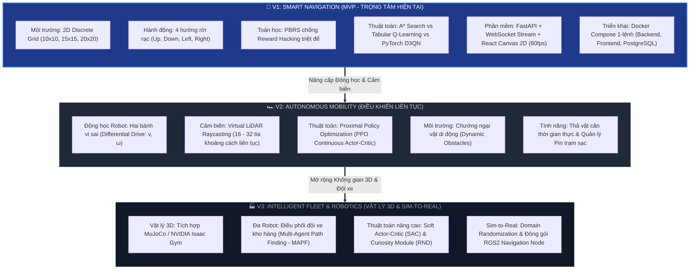
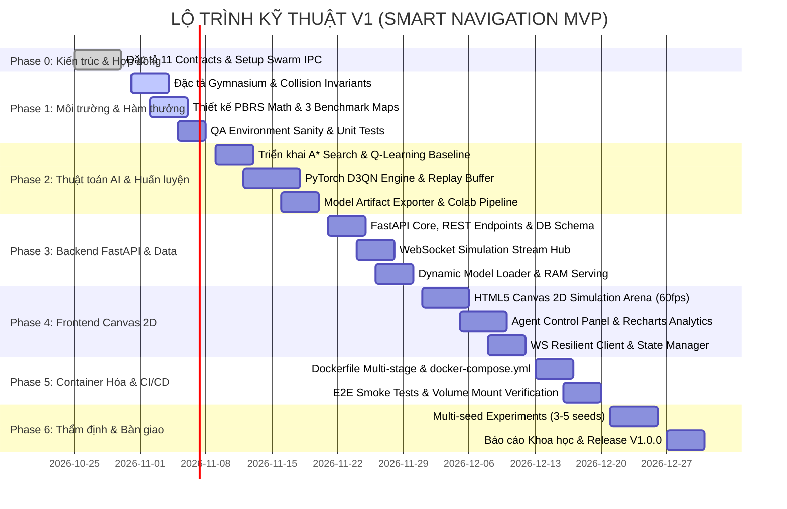

# 🗺️ ROBOPILOT — MASTER ENGINEERING ROADMAP
# CON ĐƯỜNG PHÁT TRIỂN KỸ THUẬT CHẤT LƯỢNG CAO (V1 MVP & TẦM NHÌN V2/V3)

> **Cơ quan quản trị:** Agent 0 (Project Orchestrator & System Architect) phối hợp cùng toàn thể 7 Tabs  
> **Nguyên tắc xuyên suốt:** *Chất lượng là ưu tiên số 1. Không đi đường tắt. Mọi mốc phát triển đều gắn liền với Cổng Kiểm Chứng Tự Động (Quality Gate), tiêu chuẩn nghiệm thu định lượng (DoD) và truy vết trách nhiệm qua Linqaro Swarm.*  
> **Phiên bản:** 2.0 (Master Blueprint) | **Ngày cập nhật:** 2026-10-30  

---

## 🧭 1. TRIẾT LÝ HÀNH TRÌNH (THE HIGH-INTEGRITY PATHWAY)

Dự án RoboPilot không chọn cách làm "mì ăn liền" (viết code vội trong Jupyter Notebook rồi bỏ xó). Con đường chúng ta đi là **xây dựng một hệ thống sản phẩm AI chuẩn mực công nghiệp** qua 3 nguyên tắc bất biến:

```
[ GIAI ĐOẠN THIẾT KẾ ] ──> [ MÔI TRƯỜNG & TOÁN ] ──> [ THUẬT TOÁN ĐỐI CHUẨN ] ──> [ PHẦN MỀM FULLSTACK ] ──> [ KIỂM CHỨNG KHOA HỌC ]
   (Design Phase)             (Gymnasium & PBRS)         (A* vs D3QN Engine)        (FastAPI + Canvas 2D)         (Multi-seed Benchmark)
```

1. **Nền móng trước, Nhà tầng sau:** Không viết bất kỳ dòng code thuật toán nào khi môi trường mô phỏng chưa có Unit Test chứng minh tính bất biến $O(1)$ của va chạm.
2. **Không ảo tưởng về AI:** Thuật toán cổ điển **A\* Search** luôn song hành để làm "thước đo trần" đối chuẩn. RL chỉ có giá trị khi chứng minh được phản xạ thời gian thực và khả năng thích nghi môi trường lạ.
3. **Mỗi bước đi đều có thẩm định độc lập:** Mọi Pull Request / Task hoàn thành từ Tab Coder đều phải vượt qua bài kiểm thử đối kháng (Adversarial Tests) của **Tab 7 (QA Auditor)** trước khi được Tab 1 commit.

---

## 🌟 2. TỔNG QUAN CON ĐƯỜNG 3 THẾ HỆ (EVOLUTION ROADMAP)



---

## 📅 3. CON ĐƯỜNG CHI TIẾT V1 (6 CHẶNG ĐƯỜNG KỸ THUẬT)



---

### 📍 CHẶNG 0: NỀN TẢNG KIẾN TRÚC & HỢP ĐỒNG GIAO TIẾP (PHASE 0)
* **Thời gian:** Hiện tại (Đang hoàn tất nghiệm thu)
* **Mục tiêu:** Xây dựng toàn bộ khung lý thuyết, đặc tả 11 hợp đồng kỹ thuật và cơ chế Swarm IPC qua Linqaro.
* **Đầu việc cụ thể:**
  1. Ban hành [SYSTEM_ARCHITECTURE.md](SYSTEM_ARCHITECTURE.md) và [ENGINEERING_FRAMEWORK.md](ENGINEERING_FRAMEWORK.md).
  2. Ban hành 10 quyết định kiến trúc tại [DECISION_LOG.md](DECISION_LOG.md) (ADR-001 đến ADR-010).
  3. Thiết lập cơ chế phân quyền bộ não kép tại [AGENTS.md](AGENTS.md) và [GEMINI.md](GEMINI.md).
  4. Khởi tạo cấu hình hòm thư 7 Tabs tại `.project/mailboxes/` kết nối cùng `.linqaro/`.
* **Cổng nghiệm thu (Gate 1):** Boss và Tab 1 ký duyệt toàn bộ tài liệu kiến trúc; không có xung đột giữa các hợp đồng.

---

### 📍 CHẶNG 1: MÔI TRƯỜNG GYMNASIUM & TOÁN HỌC HÀM THƯỞNG (PHASE 1)
* **Thời gian dự kiến:** Sprint 1 | **Chủ trì:** Tab 3 (@tab_3) & Tab 2 (@tab_2) | **Thẩm định:** Tab 7 (@tab_7)
* **Mục tiêu:** Tạo dựng mô phỏng môi trường nhà kho 2D đạt chuẩn Gymnasium API và mô hình toán học triệt tiêu Reward Hacking.
* **Đầu việc cụ thể:**
  1. **Tab 3 (`Simulation Designer`):**
     - Đặc tả chi tiết [docs/ENVIRONMENT_SPEC.md](docs/ENVIRONMENT_SPEC.md): Ma trận bản đồ $W \times H$, hệ tọa độ góc trên bên trái $[0,0]$.
     - Định nghĩa thuật toán va chạm biên và va chạm kệ hàng $O(1)$ tuyệt đối: Robot không thể đi xuyên tường trong mọi hoàn cảnh.
     - Thiết kế bộ 3 bản đồ chuẩn định dạng JSON: `benchmark_easy_10x10.json`, `benchmark_medium_15x15.json`, `benchmark_hard_20x20.json`.
     - Đặc tả cơ chế quan sát cảm biến lân cận (Proximity Raycast 4 hướng + Relative Goal Vector) tại [docs/STATE_ACTION_SPEC.md](docs/STATE_ACTION_SPEC.md).
  2. **Tab 2 (`RL Researcher`):**
     - Xây dựng mô hình toán học Markov Decision Process (MDP) tại [docs/RL_RESEARCH.md](docs/RL_RESEARCH.md).
     - Thiết kế công thức **Potential-based Reward Shaping ($PBRS$)** tại [docs/REWARD_DESIGN.md](docs/REWARD_DESIGN.md):
       $$\Phi(s) = - \text{Manhattan}(s_{\text{robot}}, s_{\text{goal}}), \quad F(s, s') = \gamma \Phi(s') - \Phi(s)$$
       *Chứng minh toán học triệt tiêu hoàn toàn hiện tượng đi lùi - tiến farm điểm.*
  3. **Tab 7 (`QA Auditor`):**
     - Viết kịch bản kiểm thử độc lập tại [docs/TEST_PLAN.md](docs/TEST_PLAN.md).
     - Thiết kế bài test đối kháng: Thử nghiệm cho robot chạy 1,000 bước ngẫu nhiên và kiểm tra bất biến tọa độ (Invariant Assertion).
* **Cổng nghiệm thu (Gate 2 & 4):** Môi trường vượt qua `gymnasium.utils.env_checker.check_env()`. Độ bao phủ test $\ge 90\%$.

---

### 📍 CHẶNG 2: THUẬT TOÁN AI, PIPELINE HUẤN LUYỆN & ARTIFACT (PHASE 2)
* **Thời gian dự kiến:** Sprint 2 | **Chủ trì:** Tab 4 (@tab_4) & Tab 2 (@tab_2) | **Thẩm định:** Tab 7 (@tab_7)
* **Mục tiêu:** Xây dựng thuật toán đối chuẩn A*, cài đặt mạng PyTorch Dueling Double DQN và quy trình đóng gói mô hình chuẩn.
* **Đầu việc cụ thể:**
  1. **Tab 2 (`RL Researcher`):**
     - Thiết kế thuật toán **A\* Search** với Manhattan Heuristic làm mốc đối chuẩn trần lý thuyết (Optimal Ground Truth) tại [docs/ALGORITHM_COMPARISON.md](docs/ALGORITHM_COMPARISON.md).
     - Thiết kế thuật toán **Tabular Q-Learning** làm mốc sàn học tăng cường.
  2. **Tab 4 (`Training Architect`):**
     - Thiết kế kiến trúc mạng nơ-ron **Dueling Double DQN (D3QN)** bằng PyTorch tại [docs/TRAINING_PIPELINE.md](docs/TRAINING_PIPELINE.md):
       * Tách luồng State Value $V(s)$ và Advantage $A(s, a)$.
       * Bộ nhớ Experience Replay Buffer ($50,000$ transitions).
       * Mạng Target Network đồng bộ chu kỳ $C = 1,000$ steps.
       * Loss Smooth L1 (Huber Loss), Optimizer Adam.
     - Thiết kế quy trình huấn luyện chạy độc lập trên Colab GPU và Local CLI qua biến tham số hạt giống (Random Seeds).
     - Chuẩn hóa **Model Artifact Contract** tại [docs/MODEL_LIFECYCLE.md](docs/MODEL_LIFECYCLE.md): Cặp tệp `model.pt` + `metadata.json` (chứa toàn bộ kiến trúc, layer dimensions, siêu tham số và metrics).
  3. **Tab 7 (`QA Auditor`):**
     - Kiểm tra rủi ro Policy Collapse và hiện tượng ước lượng thổi phồng (Overestimation Bias).
     - Xác thực tính độc lập của khâu huấn luyện: Tuyệt đối không phụ thuộc vào web server.
* **Cổng nghiệm thu (Gate 3 & 5):** A* tìm ra đường tối ưu $100\%$ trên cả 3 bản đồ. D3QN hoàn thành forward pass $< 2\text{ms}$ trên CPU. Model Artifact nạp thử nghiệm thành công mà không lỗi mismatch trọng số.

---

### 📍 CHẶNG 3: BACKEND FASTAPI, WEBSOCKET STREAM & DATABASE (PHASE 3)
* **Thời gian dự kiến:** Sprint 3 | **Chủ trì:** Tab 5 (@tab_5) | **Thẩm định:** Tab 7 (@tab_7)
* **Mục tiêu:** Xây dựng hệ thống phục vụ suy luận thời gian thực, stream luồng tick qua WebSocket và lưu trữ dữ liệu PostgreSQL.
* **Đầu việc cụ thể:**
  1. **Tab 5 (`Backend MLOps`):**
     - Thiết kế kiến trúc FastAPI module hóa tại [docs/BACKEND_DESIGN.md](docs/BACKEND_DESIGN.md):
       * Dependency Injection, Global Error Handling.
       * Tách biệt routers: `/api/v1/maps`, `/api/v1/models`, `/api/v1/experiments`.
     - Đặc tả giao thức WebSocket `/ws/simulation/{session_id}` tại [docs/API_SPEC.md](docs/API_SPEC.md):
       * Lệnh từ Client: `START`, `PAUSE`, `RESUME`, `RESET`, `STEP`, `SET_SPEED`.
       * Khung phát từ Server: Tọa độ robot, vệt đường đi, action, Q-values, reward, collision status.
     - Thiết kế dịch vụ nạp mô hình động **Dynamic Model Loader**: Đọc `metadata.json`, validate input/output dimensions trước khi cấp RAM nạp `model.pt` ở chế độ `torch.no_grad()`.
     - Thiết kế PostgreSQL Schema DDL tại [docs/DATABASE_SCHEMA.md](docs/DATABASE_SCHEMA.md): Bảng `maps`, `models`, `experiments`, `benchmark_runs`. Hỗ trợ fallback tự động SQLite khi test offline.
  2. **Tab 7 (`QA Auditor`):**
     - Kiểm tra khả năng chịu tải của WebSocket Hub: Đảm bảo ngắt kết nối dọn sạch session (No memory leak/zombie threads).
     - Test bảo mật: Validate mọi input qua Pydantic schemas.
* **Cổng nghiệm thu (Gate 4):** 100% API endpoints có Swagger docs hoàn chỉnh. WebSocket truyền phát đạt tốc độ $30 - 60$ ticks/giây với độ trễ phản hồi $< 10\text{ms}$.

---

### 📍 CHẶNG 4: FRONTEND CANVAS 2D ARENA & ANALYTICS DASHBOARD (PHASE 4)
* **Thời gian dự kiến:** Sprint 4 | **Chủ trì:** Tab 6 (@tab_6) | **Thẩm định:** Tab 7 (@tab_7)
* **Mục tiêu:** Xây dựng giao diện web trực quan hóa đấu trường Canvas 2D mượt mà 60 FPS và dashboard phân tích 5 modules.
* **Đầu việc cụ thể:**
  1. **Tab 6 (`Frontend Designer`):**
     - Thiết lập dự án React 18 + Vite + TypeScript với Strict Mode tại [docs/FRONTEND_ARCHITECTURE.md](docs/FRONTEND_ARCHITECTURE.md).
     - Thiết kế **Simulation Arena (HTML5 Canvas 2D)** tại [docs/UI_UX_SPEC.md](docs/UI_UX_SPEC.md):
       * Vẽ lưới kho hàng sắc nét, robot kèm icon hướng nhìn, kệ hàng, điểm Start/Goal.
       * Hiệu ứng vệt đường đi đã qua (Trajectory Trail) và hiệu ứng cảnh báo va chạm.
       * Tính năng tương tác: Click chuột thả vật cản thời gian thực (Dynamic Obstacle).
     - Xây dựng **Agent Control Panel**: Nút Play, Pause, Step-by-step, thanh trượt FPS ($1 - 30\text{Hz}$), dropdown chọn model và map.
     - Xây dựng **Analytics Dashboard** tại [docs/DASHBOARD_DESIGN.md](docs/DASHBOARD_DESIGN.md): Tích hợp Recharts vẽ biểu đồ đường cong phần thưởng, tỷ lệ thành công, và bảng đối chuẩn so sánh song song giữa A* và D3QN.
     - Quản lý kết nối WebSocket Client bền bỉ: Tự động kết nối lại khi mất mạng (Auto-reconnect & Heartbeat).
  2. **Tab 7 (`QA Auditor`):**
     - Kiểm tra hiệu năng giao diện: Đo đạc tốc độ khung hình (Frame Rate) trên các kích thước lưới khác nhau (phải duy trì $\ge 50 - 60\text{ FPS}$).
     - Kiểm tra 4 trạng thái giao diện: Loading, Error, Empty, Success.
* **Cổng nghiệm thu (Gate 3 & 4):** Giao diện chạy mượt mà, phản ánh chính xác trạng thái từ backend; không có lỗi console hay drop-frame nghiêm trọng.

---

### 📍 CHẶNG 5: ĐÓNG GÓI DOCKER COMPOSE & TỰ ĐỘNG HÓA CI/CD (PHASE 5)
* **Thời gian dự kiến:** Sprint 5 | **Chủ trì:** Tab 5 (@tab_5) & Tab 1 (@tab_1) | **Thẩm định:** Tab 7 (@tab_7)
* **Mục tiêu:** Container hóa toàn bộ hệ thống, khởi chạy 1-lệnh bằng Docker Compose và thiết lập quy trình kiểm thử tự động.
* **Đầu việc cụ thể:**
  1. **Tab 5 (`Backend MLOps`):**
     - Xây dựng `Dockerfile.backend` (Python 3.10 slim, multi-stage build, tối ưu dung lượng $< 600\text{MB}$).
     - Xây dựng `Dockerfile.frontend` (Node build ra static assets $\to$ Nginx serving).
     - Xây dựng tệp [docker-compose.yml](docker-compose.yml) tại [docs/DOCKER_DESIGN.md](docs/DOCKER_DESIGN.md) kết nối 3 services:
       * `backend`: Cổng 8000.
       * `frontend`: Cổng 3000.
       * `db`: PostgreSQL 15 kèm cờ `healthcheck` chống lỗi khởi động sớm.
       * Volume mapping thư mục `./models` và `./maps` để nạp dữ liệu ngoài container.
  2. **Tab 1 (`Orchestrator`) & Tab 7 (`QA Auditor`):**
     - Thiết lập GitHub Actions workflow (`.github/workflows/verify.yml`): Tự động chạy Linting, Static Typing (`mypy`), Environment Sanity Test và Backend Tests mỗi khi có code mới.
     - Thực hiện kiểm thử End-to-End (E2E Smoke Test): Khởi động từ máy sạch bằng `docker compose up --build` và kiểm tra toàn bộ luồng hoạt động.
* **Cổng nghiệm thu (Gate 4):** Khởi chạy 100% thành công bằng đúng 1 lệnh; mọi service đạt trạng thái `healthy` trong vòng 45 giây.

---

### 📍 CHẶNG 6: THỰC NGHIỆM ĐA HẠT NHÂN, BÁO CÁO KHOA HỌC & PHÁT HÀNH V1 (PHASE 6)
* **Thời gian dự kiến:** Sprint 6 | **Chủ trì:** Toàn bộ 7 Tabs | **Trọng tài:** Tab 7 (@tab_7) & Boss
* **Mục tiêu:** Thu thập số liệu thực nghiệm khoa học trung thực, lập báo cáo đối chuẩn toàn diện và phát hành phiên bản V1.0.0.
* **Đầu việc cụ thể:**
  1. **Chạy Automated Benchmark Suite trên 3 bản đồ chuẩn:**
     - Đánh giá 4 giải thuật: Random Walk vs A* Search vs Tabular Q-Learning vs Dueling Double DQN.
     - Thực nghiệm chạy qua ít nhất **3 - 5 Random Seeds** độc lập.
  2. **Biên soạn Báo cáo Đánh giá Khoa học (`EVALUATION_REPORT.md`):**
     - Bảng tổng hợp số liệu thực: Success Rate ($\% \pm \text{Std}$), Collision Rate ($\% \pm \text{Std}$), Average Episode Steps, Inference Latency ($\text{ms}$).
     - Phân tích khả năng Zero-shot Generalization trên bản đồ chưa từng thấy.
     - Phân tích bài học kỹ thuật: Trích xuất các case study về lỗi và phương pháp xử lý từ `FAILURE_ANALYSIS.md`.
  3. **Đóng gói Phát hành (Release V1.0.0):**
     - Quay video demo mô phỏng và cập nhật ảnh GIF trực quan vào [README.md](README.md).
     - Cập nhật nhật ký phát hành `CHANGELOG.md` và gắn tag release `v1.0.0` trên GitHub.
* **Cổng nghiệm thu (Gate 5 - Final Sign-off):** Thỏa mãn đầy đủ 8 tiêu chí nghiệm thu định lượng (Acceptance Criteria) đã cam kết tại [PROJECT_SCOPE.md](PROJECT_SCOPE.md). Boss ký duyệt hoàn thành V1!

---

## 👥 4. MA TRẬN TRÁCH NHIỆM 7 TABS THEO CHẶNG ĐƯỜNG (RACI MATRIX)

> **Quy ước:**  
> **R** (Responsible): Thực hiện chính • **A** (Accountable): Phê duyệt & Chịu trách nhiệm cuối  
> **C** (Consulted): Tham vấn / Phối hợp • **I** (Informed): Nhận thông tin / Handoff  

| Chặng đường (Milestones) | Tab 1 (Lead) | Tab 2 (RL Math) | Tab 3 (Sim) | Tab 4 (Train) | Tab 5 (Backend) | Tab 6 (Frontend) | Tab 7 (QA) |
| :--- | :---: | :---: | :---: | :---: | :---: | :---: | :---: |
| **Phase 0: Kiến trúc & Hợp đồng** | **A / R** | C | C | C | C | C | **C / R** |
| **Phase 1: Môi trường & Hàm thưởng**| A | **R** (PBRS) | **R** (Env) | C | I | I | **R** (Audit) |
| **Phase 2: Thuật toán AI & Artifact**| A | **R** (A*/Q) | C | **R** (D3QN) | C | I | **R** (Audit) |
| **Phase 3: Backend & WebSocket Hub** | A | I | C | C | **R** (FastAPI)| C | **R** (Audit) |
| **Phase 4: Frontend Canvas 2D Arena** | A | I | C | I | C | **R** (React) | **R** (Audit) |
| **Phase 5: Docker & CI/CD Pipeline** | **A / R** | I | I | C | **R** (Docker) | C | **R** (Audit) |
| **Phase 6: Benchmark & Bàn giao V1** | **A** | **R** | **R** | **R** | **R** | **R** | **A / R** (Sign) |

---

## 🔒 5. NGUYÊN TẮC QUẢN TRỊ RỦI RO & ĐIỀU KIỆN TIÊN QUYẾT (RISK CONTROL)

| Rủi ro kỹ thuật | Mức độ | Hậu quả tiềm ẩn | Biện pháp kiểm soát & Ngăn chặn |
| :--- | :---: | :--- | :--- |
| **Reward Cycling / Hacking** | `CAO` | Robot đi lùi-tiến liên tục để farm điểm mà không về đích. | Bắt buộc áp dụng Potential-based Reward Shaping ($PBRS$) với Manhattan potential; Tab 7 kiểm tra 100 episodes không giới hạn bước. |
| **Mismatch Model Artifact** | `CAO` | Backend không nạp được weights do lệch số chiều quan sát. | Bắt buộc đóng gói cặp `model.pt` + `metadata.json`; Backend tự động validate schema trước khi allocate memory. |
| **Drop FPS trên Canvas 2D** | `TRUNG BÌNH`| Lag giật màn hình khi mô phỏng bản đồ lớn $20\times 20$. | Render native HTML5 Canvas 2D theo cơ chế dirty-rectangle hoặc batch grid paths; không dùng DOM nodes. |
| **Zombie WebSocket Connections** | `TRUNG BÌNH`| Backend bị treo RAM khi nhiều client mở tab rồi đóng đột ngột. | Cài đặt Heartbeat Ping/Pong và Connection Lifecycle Manager tự động thu hồi tài nguyên sau 30 giây mất tín hiệu. |
| **Fake số liệu báo cáo** | `NGHIÊM TRỌNG`| Đánh mất uy tín nghiên cứu và tính trung thực khoa học. | Tuân thủ triệt để `GEMINI.md`: Mọi số liệu phải sinh ra từ automated script chạy qua 3-5 random seeds thực tế. |

---

## 🚀 6. TẦM NHÌN CON ĐƯỜNG TƯƠNG LAI (BEYOND V1)

Hoàn thành V1 là bước đệm vững chắc để mở ra hai cánh cửa công nghệ tiếp theo:

```
                          [ V1 THÀNH CÔNG ]
                                  │
                 ┌────────────────┴────────────────┐
                 ▼                                 ▼
      [ V2: AUTONOMOUS MOBILITY ]       [ V3: INTELLIGENT FLEET ]
      • Động học vi sai hai bánh        • Mô phỏng vật lý 3D MuJoCo
      • Cảm biến khoảng cách LiDAR      • Tối ưu đa xe kho hàng (MAPF)
      • Mạng Actor-Critic PPO           • Sim-to-Real sang Robot thật (ROS2)
```

- **Phiên bản V2:** Tháo bỏ lưới rời rạc, đưa robot vào thế giới liên tục thực tế với vận tốc tuyến tính $v$ và vận tốc góc $\omega$, xử lý vật cản chuyển động.
- **Phiên bản V3:** Bước lên không gian vật lý 3D, ứng dụng điều phối cả đội xe hàng chục chiếc trong kho thông minh của các tập đoàn Logistics lớn.

---

> **LỜI KẾT**: Đây là **bản đồ tác chiến chính thức** của RoboPilot. Toàn bộ 7 Tabs thuộc Swarm sẽ căn cứ vào lộ trình này để triển khai nhiệm vụ một cách kỷ luật, minh bạch và đặt chất lượng sản phẩm lên hàng đầu!
