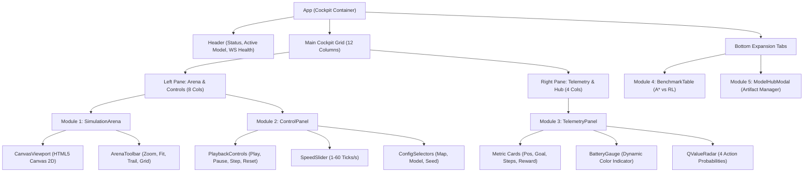
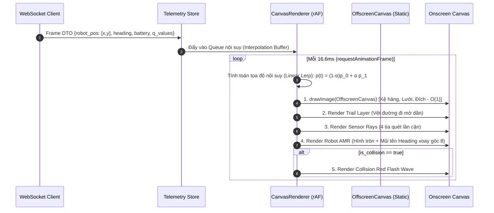
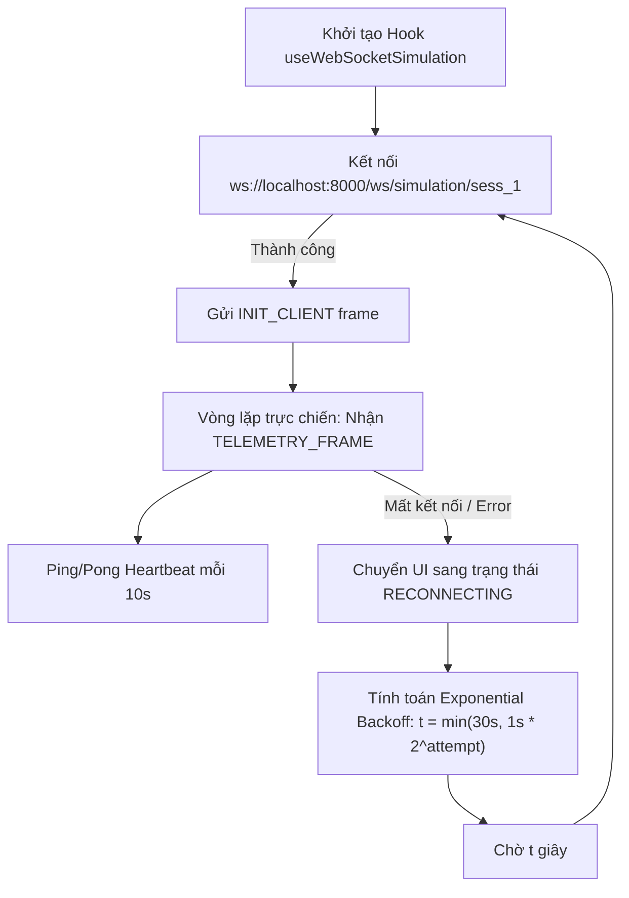

# ROBOPILOT — FRONTEND ARCHITECTURE & ENGINE SPECIFICATION
# KIẾN TRÚC ỨNG DỤNG REACT 18 VÀ BỘ MÁY KHOA HỌC CANVAS 2D (60 FPS)

> **Cơ quan phụ trách:** Tab 6 (@tab_6) — Frontend & UX/UI Designer  
> **Thẩm định:** Tab 7 (@tab_7) — QA Auditor | **Phê duyệt:** Tab 1 (@tab_1) — Orchestrator  
> **Trạng thái:** PROPOSED / PHASE 1 (Sprint 1) | **Ngày ban hành:** 2026-10-30  

---

## 1. NGĂN XẾP CÔNG NGHỆ CHUẨN MỰC (TECH STACK SPECIFICATION)

Ứng dụng Frontend của RoboPilot được xây dựng trên nền tảng công nghệ web hiện đại nhất, bảo đảm hiệu năng tính toán và hiển thị đồ họa cao:
- **Core Runtime:** React 18.3+ (Concurrent Mode, Automatic Batching).
- **Ngôn ngữ:** TypeScript 5.4+ với cấu hình `"strict": true` tuyệt đối, cấm mọi kiểu `any` và `@ts-ignore`.
- **Build Tool & Dev Server:** Vite 5.x (HMR dưới 50ms, tối ưu hóa bundle qua Rollup).
- **Quản lý trạng thái (State Management):** Zustand 4.x (Kiến trúc Store nguyên tử, không re-render dư thừa, hỗ trợ middleware subscribe ngoài React lifecycle).
- **Đồ họa Mô phỏng (Simulation Visualizer):** HTML5 Canvas 2D API bản địa (Native Context) kết hợp kỹ thuật Offscreen Canvas & Sub-pixel Interpolation.
- **Biểu đồ Khoa học (Data Visualization):** Recharts 2.x (Dựng trên SVG sắc nét, tích hợp responsive container).
- **Styling System:** Tailwind CSS 3.4+ với bảng mã màu công nghiệp đồng bộ hệ thống thiết kế.
- **Iconography:** Lucide-React (Bộ icon tối giản, nhẹ, chuẩn SVG).

---

## 2. CẤU TRÚC THƯ MỤC DỰ ÁN (`src/frontend/`)

Để tuân thủ nghiêm ngặt điều lệ trần giới hạn file ($< 400$ dòng/file), cấu trúc mã nguồn được phân rã theo miền chức năng (Feature-based Modular Architecture):

```
src/frontend/
├── index.html                       # Entry HTML template
├── vite.config.ts                   # Vite configuration (port 3000, proxy backend)
├── tsconfig.json                    # TypeScript strict compiler options
├── tailwind.config.js               # Industrial cyber palette tokens
└── src/
    ├── main.tsx                     # React root bootstrap & error boundary
    ├── App.tsx                      # Top-level cockpit layout (12-col grid)
    ├── assets/                      # Static icons, hazard textures
    ├── types/                       # Khế ước kiểu dữ liệu TypeScript đồng bộ Backend
    │   ├── map.types.ts             # Grid tiles, warehouse map layout
    │   ├── robot.types.ts           # Heading, coordinate, battery, telemetry
    │   ├── simulation.types.ts      # Action types, ticks, step frames
    │   ├── websocket.types.ts       # WS In/Out envelope protocols
    │   └── benchmark.types.ts       # Metrics, seed runs, model metadata
    ├── stores/                      # Zustand Stores tách biệt
    │   ├── useSimulationStore.ts    # Điều khiển Play/Pause/Speed/Frame buffer
    │   ├── useTelemetryStore.ts     # Trạng thái robot, Q-values, battery
    │   ├── useMapStore.ts           # Bản đồ đang chọn, start/goal/shelves
    │   └── useBenchmarkStore.ts     # Thống kê so sánh A* vs Q-Learning vs D3QN
    ├── hooks/                       # Custom React Hooks
    │   ├── useWebSocketSimulation.ts# Quản lý vòng đời WebSocket, ping-pong, retry
    │   ├── useCanvasRenderer.ts     # Vòng lặp render 60 FPS, camera pan/zoom
    │   └── useKeyboardShortcuts.ts  # Bắt phím tắt Space, S, R, [, ]
    ├── components/                  # Khối giao diện phân hệ
    │   ├── arena/                   # Module 1: Simulation Arena
    │   │   ├── SimulationArena.tsx  # Khung bọc Canvas, controls overlay
    │   │   ├── CanvasViewport.tsx   # Thẻ <canvas> và quản lý ResizeObserver
    │   │   └── ArenaToolbar.tsx     # Zoom, Fit Screen, Toggle Trail/Grid
    │   ├── controls/                # Module 2: Agent Control Panel
    │   │   ├── ControlPanel.tsx     # Bảng điều khiển trung tâm
    │   │   ├── PlaybackControls.tsx # Nút Play, Pause, Step, Reset
    │   │   ├── SpeedSlider.tsx      # Thanh kéo 1-60 ticks/s
    │   │   └── ConfigSelectors.tsx  # Chọn Map, Model Checkpoint, Seed
    │   ├── telemetry/               # Module 3: Real-Time Telemetry
    │   │   ├── TelemetryPanel.tsx   # Thẻ chỉ số tọa độ, pin, reward
    │   │   ├── BatteryGauge.tsx     # Đồng hồ hiển thị dung lượng pin
    │   │   └── QValueRadar.tsx      # Biểu đồ thanh 4 hành động rời rạc
    │   ├── benchmark/               # Module 4: Experiment & Benchmarks
    │   │   ├── BenchmarkTable.tsx   # Bảng đối chuẩn A* vs Q-Learning vs D3QN
    │   │   └── PerformanceModal.tsx # Xem chi tiết lịch sử seed
    │   └── models/                  # Module 5: Model Management Hub
    │       ├── ModelHubModal.tsx    # Danh mục models, Hot-swap loader
    │       └── ModelMetaViewer.tsx  # Hiển thị cấu trúc layer MLP
    ├── engine/                      # Bộ máy đồ họa Canvas chuyên biệt
    │   ├── CanvasRenderer.ts        # Lớp điều phối render chính
    │   ├── StaticGridLayer.ts       # Render kệ hàng, đường đi ra Offscreen Canvas
    │   ├── RobotLayer.ts            # Vẽ AMR, mũi tên heading, đèn tín hiệu
    │   ├── SensorRayLayer.ts        # Vẽ 4 tia raycast cảm biến khoảng cách
    │   └── TrailLayer.ts            # Vẽ vệt di chuyển làm mờ dần
    └── services/                    # Tầng giao tiếp mạng
        ├── api.client.ts            # REST client gọi FastAPI (/api/v1/*)
        └── ws.client.ts             # WebSocket wrapper với binary/JSON parser
```

---

## 3. SƠ ĐỒ PHÂN CẤP COMPONENT (COMPONENT HIERARCHY)



---

## 4. BỘ MÁY ĐỒ HỌA CANVAS 2D TỐC ĐỘ CAO (60 FPS RENDERING ENGINE)

Để đảm bảo hiệu năng 60 FPS mượt mà kể cả khi bản đồ mở rộng tới $50 \times 50$ ô và tick-rate backend đẩy lên 60 bước/giây, bộ máy đồ họa áp dụng 3 kỹ thuật tối ưu hóa chuyên sâu:



### 4.1. Kỹ thuật Tách lớp Đồ họa với Offscreen Canvas (Layered Caching)
- **Tầng tĩnh (Static Background Layer):** Lưới ô vuông, các kệ hàng tĩnh (`OBSTACLE`), ô xuất phát (`START`), ô đích (`GOAL`) và trạm sạc (`CHARGER`) chỉ được render **DUY NHẤT 1 LẦN** lên một `OffscreenCanvas` khi nạp bản đồ.
- **Tầng động (Dynamic Foreground Layer):** Ở mỗi frame $16.6\text{ ms}$, Canvas chính chỉ thực hiện một lệnh `ctx.drawImage(offscreenCanvas, 0, 0)` với độ phức tạp $O(1)$, sau đó chỉ vẽ đè xe robot, vệt đường đi và tia cảm biến. Kỹ thuật này giảm tải $90\%$ số lệnh vẽ path phức tạp.

### 4.2. Thuật toán Nội suy Tọa độ Mượt mà (Sub-pixel Linear Interpolation)
Khi backend gửi tick di chuyển theo bước nhảy ô nguyên $(x_0, y_0) \to (x_1, y_1)$ ở tần số ví dụ $10\text{ ticks/s}$ ($100\text{ ms}$/bước), nếu vẽ trực tiếp xe sẽ bị giật từng ô. Engine frontend sử dụng thuật toán nội suy Lerp:

$$\vec{P}(t) = (1 - \lambda) \vec{P}_{\text{prev}} + \lambda \vec{P}_{\text{target}}, \quad \text{với } \lambda = \min\left(1.0, \frac{\Delta t_{\text{elapsed}}}{\Delta t_{\text{tick}}}\right)$$

- Góc quay xe ($\theta$) cũng được nội suy vòng góc ngắn nhất (Shortest Arc Angle Lerp) để xe quay đầu mượt mà khi đổi hướng:
  $$\Delta \theta = ((\theta_{\text{target}} - \theta_{\text{prev}} + 540^\circ) \pmod{360^\circ}) - 180^\circ$$
  $$\theta(t) = \theta_{\text{prev}} + \lambda \Delta \theta$$

---

## 5. KIẾN TRÚC CLIENT WEBSOCKET BỀN VỮNG (RESILIENT WEBSOCKET PIPELINE)

Để duy trì kết nối stream liên tục không gián đoạn giữa React và FastAPI `/ws/simulation/{session_id}`:



### 5.1. Bộ đệm Khung hình (Frame Buffer & Telemetry Throttling)
- Để tránh hiện tượng làm nghẽn Event Loop của React khi backend stream với tốc độ cao ($60\text{ FPS}$), dữ liệu frame từ WebSocket không gọi `setState` trực tiếp ở từng gói tin.
- Dữ liệu được đưa thẳng vào **Zustand Transient Ref Buffer**; chỉ kích hoạt React re-render ở các widget văn bản với tần số giới hạn $15\text{ Hz}$ (Throttled $66\text{ ms}$), trong khi Canvas Renderer đọc trực tiếp từ Buffer ở tần số $60\text{ FPS}$.

---

## 6. KHẾ ƯỚC KIỂU DỮ LIỆU TYPESCRIPT BẮT BUỘC (CONTRACT SCHEMAS)

```typescript
// 1. Khế ước ô lưới bản đồ
export type GridTileType = 0 | 1 | 2 | 3 | 4; // 0:EMPTY, 1:OBSTACLE, 2:START, 3:GOAL, 4:CHARGER

export interface WarehouseMap {
  id: string;
  name: string;
  width: number;
  height: number;
  grid: GridTileType[][];
  startPos: [number, number];
  goalPos: [number, number];
  chargers: [number, number][];
}

// 2. Khế ước trạng thái Telemetry Robot
export type HeadingDirection = 'UP' | 'DOWN' | 'LEFT' | 'RIGHT';

export interface RobotTelemetry {
  pos: [number, number];
  heading: HeadingDirection;
  angle: number; // 0, 90, 180, 270 degrees
  batteryLevel: number; // 0.0 -> 100.0%
  stepCount: number;
  cumulativeReward: number;
  distanceToGoal: number;
  isCollision: boolean;
  isGoal: boolean;
  isLowBattery: boolean;
  proximityRays: [number, number, number, number]; // UP, DOWN, LEFT, RIGHT [0.0 - 1.0]
}

// 3. Khế ước Gói tin WebSocket Frame
export interface SimulationFrameDTO {
  sessionId: string;
  frameId: number;
  timestamp: number;
  robot: RobotTelemetry;
  lastAction: {
    actionId: 0 | 1 | 2 | 3;
    actionName: HeadingDirection;
    qValues: [number, number, number, number]; // Q(s, UP), Q(s, DOWN), Q(s, LEFT), Q(s, RIGHT)
  };
  envState: {
    terminated: boolean;
    truncated: boolean;
    terminationReason?: 'GOAL_REACHED' | 'BATTERY_DEPLETED' | 'STEP_LIMIT';
  };
}

// 4. Khế ước Lệnh điều khiển gửi lên Backend (Client to Server)
export type ClientActionCommand =
  | { type: 'PLAY' }
  | { type: 'PAUSE' }
  | { type: 'STEP' }
  | { type: 'RESET'; seed?: number }
  | { type: 'SET_SPEED'; ticksPerSecond: number }
  | { type: 'LOAD_MAP'; mapId: string }
  | { type: 'LOAD_MODEL'; modelId: string };
```

---

## 7. NGÂN SÁCH HIỆU NĂNG & TIÊU CHUẨN ĐO LƯỜNG (PERFORMANCE BUDGET)

| Chỉ số hiệu năng (KPI) | Giới hạn tối đa (Budget Ceiling) | Biện pháp kỹ thuật kiểm soát |
| :--- | :---: | :--- |
| **FPS của Canvas Arena** | $\ge 58\text{ FPS}$ (Target $60\text{ FPS}$) | Offscreen Canvas background, Lerp nội suy chuyển động |
| **Độ trễ vẽ khung (Render Latency)**| $\le 16.6\text{ ms}$ / frame | Hạn chế allocate object mới trong vòng lặp animation |
| **Thời gian nạp ban đầu (TTI)** | $\le 1.2\text{ giây}$ | Dynamic import cho các module modal nặng (Recharts) |
| **Dung lượng Bundle JS nén** | $\le 250\text{ KB}$ Gzip | Code splitting theo route & component |
| **Tiêu thụ Bộ nhớ Ram (RAM Footprint)**| $\le 80\text{ MB}$ | Giới hạn mảng lưu vết đường đi (Trail Buffer $\le 500$ điểm) |
