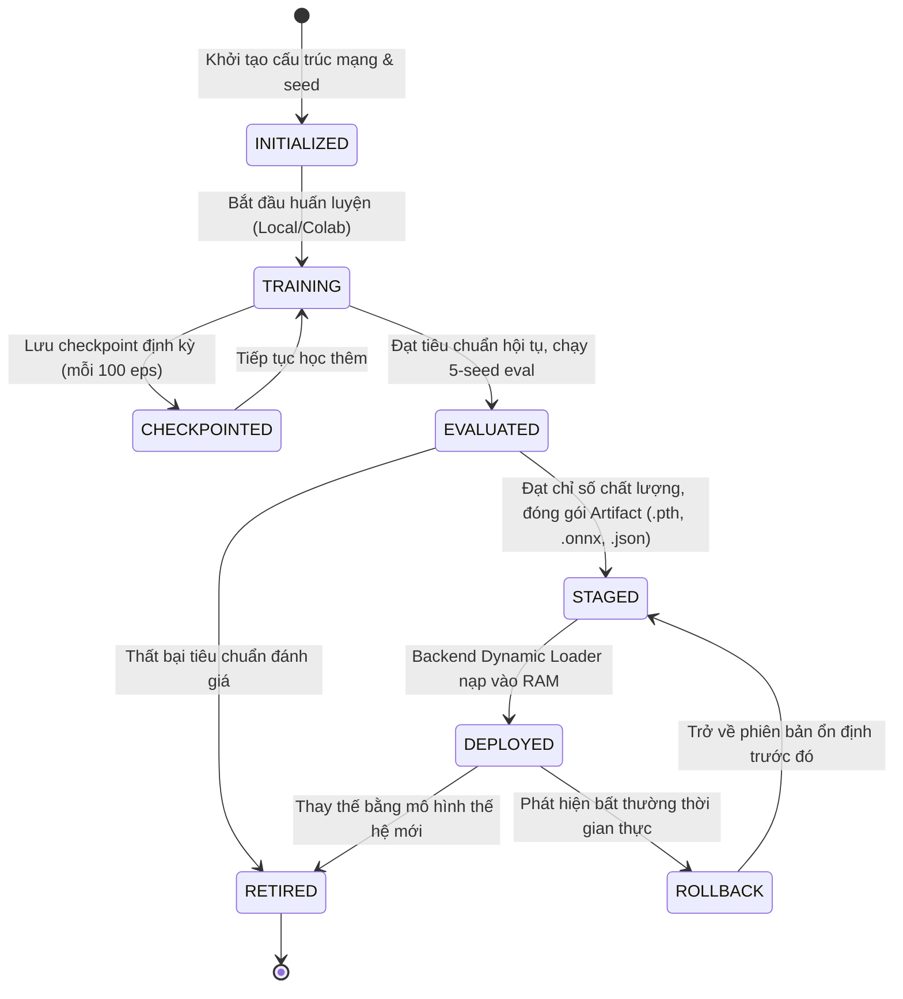
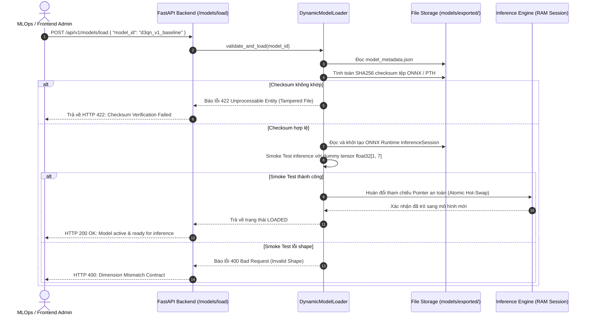

# ROBOPILOT — MODEL LIFECYCLE & ARTIFACT SPECIFICATION
# QUẢN TRỊ VÒNG ĐỜI MÔ HÌNH VÀ ĐẶC TẢ HỢP ĐỒNG GÓI MÔ HÌNH HỌC TĂNG CƯỜNG (CONTRACT #6)

> **Cơ quan phụ trách:** Tab 4 (@tab_4) — ML/RL Engineer & Training Architect  
> **Thẩm định:** Tab 7 (@tab_7) — QA Auditor | **Phê duyệt:** Tab 1 (@tab_1) — Orchestrator  
> **Tiêu thụ chính:** Tab 5 (@tab_5) — Backend MLOps  
> **Trạng thái:** DRAFT / PHASE 1 (Sprint 1) | **Ngày ban hành:** 2026-10-30  

---

## 1. TỔNG QUAN VÒNG ĐỜI MÔ HÌNH (MODEL LIFECYCLE OVERVIEW)

Trong hệ thống RoboPilot, một mô hình RL không chỉ đơn thuần là tệp lưu trọng số, mà là một thực thể hoàn chỉnh trải qua 7 trạng thái kiểm soát chặt chẽ từ khi khởi tạo tới khi khai thác suy luận thời gian thực.

### Sơ đồ Máy Trạng thái Vòng đời (State Machine Diagram)



---

## 2. CHIẾN LƯỢC LƯU CHECKPOINT VÀ PHỤC HỒI ĐẢM BẢO TÍNH TÁI LẬP (CHECKPOINTING & DETERMINISTIC RESUME)

### 2.1. Tần suất lưu vết Checkpoint
Trong quá trình huấn luyện 1,500 episodes:
1. **Checkpoint Định kỳ (Periodic Checkpoints):** Tự động lưu sau mỗi $100$ episodes (ví dụ: `checkpoint_ep100.pt`, `checkpoint_ep200.pt`,...).
2. **Checkpoint Tối ưu (Best Checkpoint):** Tự động ghi đè tệp `checkpoint_best.pt` mỗi khi chỉ số Mean Evaluation Reward (tính trên 10 test episodes không có exploration $\epsilon=0$) vượt kỷ lục cũ.
3. **Checkpoint Kết thúc (Final Checkpoint):** Lưu trạng thái hoàn tất tại episode cuối cùng `checkpoint_final.pt`.

### 2.2. Cấu trúc Payload của Checkpoint PyTorch
Để bảo đảm khả năng phục hồi huấn luyện chính xác 100% không mất mát thông tin (deterministic resume), tệp `.pt` bắt buộc phải chứa các đối tượng sau:

```python
checkpoint_payload = {
    "protocol_version": "1.0",
    "episode": episode_index,
    "total_steps": total_interaction_steps,
    "epsilon": current_epsilon_value,
    # Trọng số mạng
    "online_network_state_dict": online_net.state_dict(),
    "target_network_state_dict": target_net.state_dict(),
    # Trạng thái thuật toán tối ưu & scheduler
    "optimizer_state_dict": optimizer.state_dict(),
    # Trạng thái sinh số ngẫu nhiên để tái lập tuyệt đối
    "rng_states": {
        "python_rng": random.getstate(),
        "numpy_rng": np.random.get_state(),
        "torch_cpu_rng": torch.get_rng_state(),
        "torch_cuda_rng": torch.cuda.get_rng_state_all() if torch.cuda.is_available() else None,
    },
    # Lịch sử hiệu năng đánh giá
    "best_eval_reward": best_reward_score,
    "rolling_success_rate": current_success_rate
}
```

---

## 3. ĐẶC TẢ HỢP ĐỒNG GÓI MÔ HÌNH (MODEL ARTIFACT PACKAGE SPECIFICATION)

Khi một mô hình vượt qua quá trình kiểm định, nó được xuất xưởng thành một gói độc lập (Model Artifact Package) đặt tại thư mục `models/exported/<model_id>/`.

### 3.1. Cấu trúc Thư mục Chuẩn
```
models/
├── checkpoints/                        # Checkpoints trung gian phục vụ huấn luyện
│   ├── d3qn_warehouse_ep1000.pt
│   └── d3qn_warehouse_best.pt
└── exported/                           # Gói Artifact chính thức bàn giao cho Tab 5 Backend
    └── d3qn_v1_baseline/
        ├── model_weights.pth           # PyTorch state_dict nguyên bản
        ├── model_inference.onnx        # Tệp suy luận ONNX tối ưu hóa CPU
        ├── model_metadata.json         # Siêu dữ liệu, chữ ký sha256 và contract
        └── benchmark_evaluation.json   # Kết quả đánh giá thực nghiệm đa seed
```

### 3.2. Đặc tả JSON Schema của `model_metadata.json`
Tệp `model_metadata.json` là bản hợp đồng định dạng JSON Schema mà Tab 5 (Backend MLOps) dùng để xác thực trước khi nạp vào bộ nhớ RAM phục vụ API:

```json
{
  "$schema": "https://json-schema.org/draft/2020-12/schema",
  "title": "RoboPilotModelMetadata",
  "type": "object",
  "required": [
    "model_id",
    "model_name",
    "version",
    "framework",
    "architecture",
    "environment_contract",
    "checksums",
    "hyperparameters",
    "quality_metrics",
    "created_at"
  ],
  "properties": {
    "model_id": {
      "type": "string",
      "pattern": "^[a-z0-9_-]+$",
      "example": "d3qn_warehouse_v1_20261030"
    },
    "model_name": {
      "type": "string",
      "example": "Dueling Double DQN Warehouse Navigator"
    },
    "version": {
      "type": "string",
      "pattern": "^\\d+\\.\\d+\\.\\d+$",
      "example": "1.0.0"
    },
    "framework": {
      "type": "object",
      "properties": {
        "name": { "type": "string", "enum": ["PyTorch"] },
        "version": { "type": "string", "example": "2.2.0+cu121" },
        "onnx_version": { "type": "string", "example": "1.16.0" },
        "opset_version": { "type": "integer", "example": 17 }
      },
      "required": ["name", "version", "onnx_version", "opset_version"]
    },
    "architecture": {
      "type": "object",
      "properties": {
        "class_name": { "type": "string", "enum": ["DuelingDQN"] },
        "hidden_layers": { "type": "array", "items": { "type": "integer" }, "example": [128, 128] },
        "dueling_streams": {
          "type": "object",
          "properties": {
            "value_stream": { "type": "array", "items": { "type": "integer" }, "example": [64, 1] },
            "advantage_stream": { "type": "array", "items": { "type": "integer" }, "example": [64, 4] }
          },
          "required": ["value_stream", "advantage_stream"]
        }
      },
      "required": ["class_name", "hidden_layers", "dueling_streams"]
    },
    "environment_contract": {
      "type": "object",
      "description": "Ràng buộc khớp 100% với Observation & Action contract của Tab 3",
      "properties": {
        "observation_dim": { "type": "integer", "const": 7 },
        "action_dim": { "type": "integer", "const": 4 },
        "action_mapping": {
          "type": "array",
          "items": { "type": "string" },
          "example": ["UP", "DOWN", "LEFT", "RIGHT"]
        },
        "observation_keys": {
          "type": "array",
          "items": { "type": "string" },
          "example": ["ray_up", "ray_down", "ray_left", "ray_right", "delta_x", "delta_y", "dist_norm"]
        }
      },
      "required": ["observation_dim", "action_dim", "action_mapping", "observation_keys"]
    },
    "checksums": {
      "type": "object",
      "properties": {
        "model_weights_sha256": {
          "type": "string",
          "pattern": "^[a-f0-9]{64}$",
          "example": "e3b0c44298fc1c149afbf4c8996fb92427ae41e4649b934ca495991b7852b855"
        },
        "model_inference_onnx_sha256": {
          "type": "string",
          "pattern": "^[a-f0-9]{64}$",
          "example": "d41d8cd98f00b204e9800998ecf8427e00000000000000000000000000000000"
        }
      },
      "required": ["model_weights_sha256", "model_inference_onnx_sha256"]
    },
    "hyperparameters": {
      "type": "object",
      "properties": {
        "learning_rate": { "type": "number", "example": 0.001 },
        "gamma": { "type": "number", "example": 0.99 },
        "tau": { "type": "number", "example": 0.005 },
        "batch_size": { "type": "integer", "example": 64 },
        "buffer_capacity": { "type": "integer", "example": 50000 }
      },
      "required": ["learning_rate", "gamma", "tau", "batch_size", "buffer_capacity"]
    },
    "quality_metrics": {
      "type": "object",
      "description": "Số liệu đánh giá chuẩn qua 5 random seeds",
      "properties": {
        "seeds_evaluated": { "type": "array", "items": { "type": "integer" }, "example": [42, 1337, 2026, 9999, 777] },
        "mean_success_rate": { "type": "number", "minimum": 0.0, "maximum": 1.0, "example": 0.96 },
        "std_success_rate": { "type": "number", "example": 0.02 },
        "mean_steps_to_goal": { "type": "number", "example": 14.8 },
        "std_steps_to_goal": { "type": "number", "example": 1.2 },
        "mean_cumulative_reward": { "type": "number", "example": 89.4 },
        "std_cumulative_reward": { "type": "number", "example": 4.1 }
      },
      "required": ["seeds_evaluated", "mean_success_rate", "std_success_rate", "mean_steps_to_goal", "std_steps_to_goal"]
    },
    "created_at": {
      "type": "string",
      "format": "date-time",
      "example": "2026-10-30T15:00:00Z"
    }
  }
}
```

---

## 4. QUY TRÌNH XUẤT KHẨU VÀ KIỂM CHỨNG ONNX (ONNX EXPORT & VERIFICATION)

Định dạng ONNX (Open Neural Network Exchange) được chỉ định là định dạng chính phục vụ suy luận thời gian thực trên Backend FastAPI nhằm loại bỏ phụ thuộc nặng vào PyTorch runtime khi chạy production.

### 4.1. Quy trình Xuất khẩu Python
```python
def export_model_to_onnx(
    model: DuelingDQN,
    export_path: str,
    obs_dim: int = 7,
    opset_version: int = 17
) -> None:
    """Xuất khẩu mô hình PyTorch sang định dạng ONNX tiêu chuẩn."""
    model.eval()
    dummy_input = torch.randn(1, obs_dim, dtype=torch.float32)
    
    torch.onnx.export(
        model,
        dummy_input,
        export_path,
        export_params=True,
        opset_version=opset_version,
        do_constant_folding=True,
        input_names=["observation"],
        output_names=["q_values"],
        dynamic_axes={
            "observation": {0: "batch_size"},
            "q_values": {0: "batch_size"}
        }
    )
```

### 4.2. Tiêu chí Kiểm chứng Sai số (Numerical Equivalence Check)
Sau khi xuất tệp `.onnx`, quy trình kiểm tra bắt buộc chạy 1,000 vector quan sát ngẫu nhiên song song trên PyTorch và ONNX Runtime:
$$\max_{i=1 \dots 1000} \| Q_{\text{PyTorch}}(o_i) - Q_{\text{ONNX}}(o_i) \|_{\infty} < 10^{-5}$$
- Nếu độ lệch vượt quá $10^{-5} \to$ Từ chối đóng gói Artifact và kích hoạt cảnh báo lỗi tương thích phép toán (operator mismatch).

---

## 5. HỢP ĐỒNG NẠP ĐỘNG VỚI TAB 5 (DYNAMIC MODEL LOADER CONTRACT)

Backend FastAPI (`src/backend/services/model_loader.py`) phải tuân thủ nghiêm ngặt giao thức sau:



### 5.1. Cơ chế Hoán đổi Nguyên tử không Gián đoạn (Atomic Hot-Swap)
- Bộ suy luận Backend duy trì một con trỏ thread-safe (sử dụng `threading.Lock` hoặc `asyncio.Lock`).
- Quá trình nạp mô hình mới, xác thực SHA256 và khởi tạo ONNX session diễn ra độc lập trong nền.
- Chỉ khi session mới sẵn sàng và vượt qua smoke test, con trỏ suy luận mới được hoán đổi sang session mới trong thời gian dưới $1\text{ms}$, bảo đảm không làm đứt kết nối WebSocket hay làm trễ luồng mô phỏng.

### 5.2. Cơ chế Hoàn nguyên (Rollback Mechanism)
- Hệ thống luôn giữ lại phiên bản mô hình trước đó (`fallback_session`) trong bộ nhớ RAM trong ít nhất 10 phút.
- Nếu trong 50 bước mô phỏng đầu tiên với mô hình mới xuất hiện ngoại lệ suy luận hoặc robot có tỷ lệ va chạm liên tục $> 50\%$, Backend tự động kích hoạt cờ Rollback, đảo con trỏ về `fallback_session` và ghi nhật ký cảnh báo `CRITICAL_ANOMALY`.
