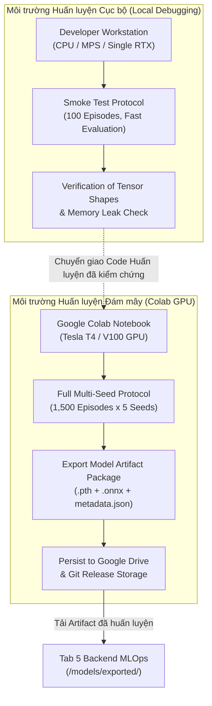

# ROBOPILOT — REINFORCEMENT LEARNING TRAINING PIPELINE SPECIFICATION
# ĐẶC TẢ QUY TRÌNH HUẤN LUYỆN RL, KIẾN TRÚC MẠNG NƠ-RON VÀ THUẬT TOÁN HỌC TĂNG CƯỜNG

> **Cơ quan phụ trách:** Tab 4 (@tab_4) — ML/RL Engineer & Training Architect  
> **Thẩm định:** Tab 7 (@tab_7) — QA Auditor | **Phê duyệt:** Tab 1 (@tab_1) — Orchestrator  
> **Tiêu thụ:** Tab 5 (@tab_5) — Backend MLOps | Tab 2 (@tab_2) — RL Researcher  
> **Trạng thái:** DRAFT / PHASE 1 (Sprint 1) | **Ngày ban hành:** 2026-10-30  

---

## 1. TỔNG QUAN VÀ MỤC TIÊU HUẤN LUYỆN (OVERVIEW & OBJECTIVES)

Tài liệu này xác lập quy trình công nghệ toàn diện cho quá trình huấn luyện mô hình học tăng cường sâu (Deep Reinforcement Learning - DRL) cho xe tự hành chở hàng (AMR) trong môi trường kho vận RoboPilot V1.

### 1.1. Mục tiêu kỹ thuật cốt lõi
1. **Ổn định hóa hội tụ (Convergence Stability):** Triệt tiêu hiện tượng ước lượng quá mức (positive maximization bias) và dao động giá trị Q trong mạng nơ-ron xấp xỉ.
2. **Khả năng khái quát hóa (Generalization Capability):** Tác tử học cách ra quyết định điều hướng dựa trên vector cảm biến tương đối $\mathbb{R}^7$, có khả năng vượt chướng ngại vật ở các bản đồ kho chưa từng xuất hiện trong tập huấn luyện.
3. **Môi trường thực thi kép (Dual Execution Pipeline):** Hỗ trợ huấn luyện cục bộ (Local CPU/GPU phục vụ debug và smoke tests) và điện toán đám mây (Google Colab GPU T4/V100 cho các thí nghiệm quy mô lớn).
4. **Chuẩn hóa Hợp đồng Kỹ thuật (Technical Contract #5):** Cung cấp giao diện đóng gói rõ ràng, không phụ thuộc framework cho Backend và MLOps.

---

## 2. KIẾN TRÚC MẠNG NƠ-RON DUELING DOUBLE DQN (D3QN)

RoboPilot V1 sử dụng biến thể tiên tiến **Dueling Double Deep Q-Network (D3QN)** kết hợp cơ chế Soft Target Update (Polyak Averaging).

```
                            +---------------------------------------------+
                            |       Input Vector: o_t in R^7              |
                            | [4 rays, delta_x, delta_y, dist_norm]       |
                            +---------------------------------------------+
                                                   |
                                                   v
                            +---------------------------------------------+
                            |      Feature Extractor Shared Backbone      |
                            |  Linear(7 -> 128) -> LayerNorm -> ReLU      |
                            |  Linear(128 -> 128) -> ReLU                 |
                            +---------------------------------------------+
                                                   |
                               +-------------------+-------------------+
                               |                                       |
                               v                                       v
                +-----------------------------+         +-----------------------------+
                |    Value Stream V(s)        |         |   Advantage Stream A(s, a)  |
                |  Linear(128 -> 64) -> ReLU  |         |  Linear(128 -> 64) -> ReLU  |
                |  Linear(64 -> 1)            |         |  Linear(64 -> 4)            |
                |  Output: Scalar V(s)        |         |  Output: Vector A(s, :)     |
                +-----------------------------+         +-----------------------------+
                               \                                       /
                                \                                     /
                                 v                                   v
                            +---------------------------------------------+
                            |            Dueling Aggregation Layer        |
                            |  Q(s, a) = V(s) + (A(s, a) - 1/|A| Sum A)   |
                            |  Output: Q-values for 4 Discrete Actions    |
                            +---------------------------------------------+
```

### 2.1. Phân tách Dueling Architecture và Tính định danh (Identifiability)
Trong bài toán điều hướng AMR, có nhiều trạng thái mà việc rẽ hướng không tạo ra khác biệt lớn, nhưng bản thân trạng thái đó rất an toàn hoặc rất nguy hiểm (ví dụ: đang ở trong ngõ cụt thì chọn hành động nào cũng rủi ro). Kiến trúc Dueling phân rã hàm giá trị hành động $Q(s, a)$ thành:
- **Hàm giá trị trạng thái $V(s)$**: Đánh giá độ tốt tổng quát của trạng thái hiện tại.
- **Hàm lợi thế $A(s, a)$**: Đánh giá tầm quan trọng tương đối của hành động $a$ so với các hành động khác:

$$Q(s, a; \theta, \alpha, \beta) = V(s; \theta, \beta) + \left( A(s, a; \theta, \alpha) - \frac{1}{|\mathcal{A}|} \sum_{a' \in \mathcal{A}} A(s, a'; \theta, \alpha) \right)$$

*Trong đó:*
- $\theta$: Trọng số của Shared Feature Extractor.
- $\beta$: Trọng số của nhánh ước lượng Value.
- $\alpha$: Trọng số của nhánh ước lượng Advantage.
- Việc trừ đi giá trị trung bình $\frac{1}{|\mathcal{A}|} \sum_{a'} A(s, a')$ giúp triệt tiêu bậc tự do (unidentifiability), ép trung bình nhánh Advantage bằng $0$, giúp $V(s)$ hội tụ đúng về hàm giá trị trạng thái thực $V^\pi(s)$.

### 2.2. Triệt tiêu Thiên lệch Ước lượng với Double DQN (DDQN)
DQN tiêu chuẩn sử dụng chung một mạng nơ-ron để vừa chọn hành động cực đại vừa ước lượng giá trị của hành động đó, dẫn tới hiện tượng tích lũy sai số thiên lệch dương (overestimation bias).
Double DQN tách rời hai quá trình này:
1. **Chọn hành động tốt nhất** bằng trọng số mạng online $\theta$:
   $$a^* = \arg\max_{a'} Q(s_{t+1}, a'; \theta_t)$$
2. **Đánh giá giá trị hành động đó** bằng trọng số mạng mục tiêu $\theta^-$:
   $$y_t^{\text{DDQN}} = r_t + \gamma (1 - d_t) \cdot Q(s_{t+1}, a^*; \theta^-_t)$$

*Trong đó:*
- $d_t \in \{0, 1\}$ là cờ kết thúc do trạng thái kết thúc (terminal goal hoặc collision).
- **Quy tắc Gymnasium Time-limit:** Nếu episode dừng do vượt quá số bước tối đa (`truncated = True`), $d_t$ được gán bằng $0$ để không làm biến dạng phép ước lượng tương lai bootstrap $V(s_{t+1})$.

### 2.3. Hàm mất mát Robust Huber Loss (Smooth L1 Loss)
Để bảo vệ mô hình khỏi các xung đột gradient lớn khi robot va chạm (phần thưởng phạt âm lớn $-10.0$ hoặc $-20.0$), hàm mất mát Smooth L1 (Huber Loss) với ngưỡng $\delta = 1.0$ được áp dụng thay cho MSE ($L_2$):

$$\mathcal{L}(\theta) = \frac{1}{B} \sum_{i=1}^B \text{Huber}_\delta \left( y_i - Q(s_i, a_i; \theta) \right)$$

$$\text{Huber}_\delta(e) = \begin{cases} 
0.5 \cdot e^2 & \text{nếu } |e| \le \delta \\
\delta \cdot (|e| - 0.5 \cdot \delta) & \text{ngược lại}
\end{cases}$$

---

## 3. THIẾT KẾ BỘ NHỚ ĐỆM KINH NGHIỆM (EXPERIENCE REPLAY BUFFER)

### 3.1. Cấu trúc Transition và Lưu trữ Vectorized
Replay Buffer lưu trữ các bộ 5 phần tử $(s_t, a_t, r_t, s_{t+1}, d_t)$ dưới dạng mảng NumPy liên tục (pre-allocated continuous memory buffers) nhằm tối ưu băng thông nạp vào GPU:
- `obs_buf`: Hình dạng $(N, 7)$, kiểu `np.float32`.
- `act_buf`: Hình dạng $(N,)$, kiểu `np.int64`.
- `rew_buf`: Hình dạng $(N,)$, kiểu `np.float32`.
- `next_obs_buf`: Hình dạng $(N, 7)$, kiểu `np.float32`.
- `done_buf`: Hình dạng $(N,)$, kiểu `np.float32` (1.0 nếu terminal, 0.0 nếu tiếp tục).

### 3.2. Thông số Replay Buffer
| Thuộc tính | Giá trị cấu hình | Giải thích lý thuyết |
| :--- | :---: | :--- |
| **Capacity ($N$)** | $50,000$ bước | Đủ lớn để phá vỡ tương quan chuỗi thời gian (temporal correlation), không gây tràn RAM máy tính cá nhân (~15 MB RAM). |
| **Warmup Steps** | $1,000$ bước | Thu thập kinh nghiệm bằng chính sách ngẫu nhiên trước khi khởi động tối ưu hóa gradient. |
| **Batch Size ($B$)** | $64$ mẫu | Kích thước minibatch cân bằng giữa độ chính xác ước lượng gradient và tốc độ tính toán. |

---

## 4. CHIẾN LƯỢC ĐỒNG BỘ TARGET NETWORK VÀ THĂM DÒ (EXPLORATION)

### 4.1. Cơ chế Cập nhật Mạng Mục tiêu (Soft Polyak Averaging)
Thay vì sao chép toàn bộ trọng số (Hard Update) sau mỗi $C$ bước gây giật gradient (instability cliff), RoboPilot V1 áp dụng cập nhật mềm sau mỗi bước huấn luyện:
$$\theta^- \leftarrow \tau \theta + (1 - \tau) \theta^- \quad \text{với } \tau = 0.005$$
- Mạng target di chuyển mượt mà bám theo mạng chính, loại bỏ hoàn toàn các cú sốc giá trị $Q$.

### 4.2. Chiến lược Thăm dò $\epsilon$-Greedy Phân rã Tuyến tính
Chính sách hành động $\pi(a \mid s)$ được xác định bởi:
$$\pi(a \mid s) = \begin{cases} 
\text{Hành động ngẫu nhiên đồng đều trong } \{0, 1, 2, 3\} & \text{với xác suất } \epsilon \\
\arg\max_{a} Q(s, a; \theta) & \text{với xác suất } 1 - \epsilon
\end{cases}$$

Quy luật phân rã tuyến tính theo từng bước tương tác ($t$):
$$\epsilon_t = \max\left(\epsilon_{\text{min}}, \epsilon_{\text{start}} - t \times \frac{\epsilon_{\text{start}} - \epsilon_{\text{min}}}{T_{\text{decay}}}\right)$$

| Tham số | Giá trị | Ý nghĩa |
| :--- | :---: | :--- |
| $\epsilon_{\text{start}}$ | $1.0$ | Khởi đầu thăm dò 100% không gian kho hàng. |
| $\epsilon_{\text{min}}$ | $0.05$ | Giữ lại 5% thăm dò để tránh bẫy cực tiểu địa phương. |
| $T_{\text{decay}}$ | $25,000$ steps | Phân rã từ từ qua khoảng 200 episodes đầu tiên. |

---

## 5. THUẬT TOÁN HUẤN LUYỆN ĐẦY ĐỦ (TRAINING PSEUDOCODE)

Dưới đây là mã giả thuật toán với 100% Python Type Hints, tuân thủ chuẩn PEP 8 và tương thích hoàn toàn với kiến trúc PyTorch 2.x:

```python
"""
RoboPilot V1 — Dueling Double DQN Training Algorithm
Tuân thủ nghiêm ngặt Hợp đồng Quan sát 7-chiều và Hành động 4-chiều.
"""
from typing import Dict, Tuple, Any
import numpy as np
import torch
import torch.nn as nn
import torch.optim as optim

class DuelingDQN(nn.Module):
    """Mạng Dueling Deep Q-Network cho điều hướng xe tự hành."""
    def __init__(self, obs_dim: int = 7, act_dim: int = 4) -> None:
        super().__init__()
        # Backbone trích xuất đặc trưng
        self.feature_network = nn.Sequential(
            nn.Linear(obs_dim, 128),
            nn.LayerNorm(128),
            nn.ReLU(),
            nn.Linear(128, 128),
            nn.ReLU()
        )
        
        # Nhánh ước lượng State Value V(s)
        self.value_stream = nn.Sequential(
            nn.Linear(128, 64),
            nn.ReLU(),
            nn.Linear(64, 1)
        )
        
        # Nhánh ước lượng Advantage A(s, a)
        self.advantage_stream = nn.Sequential(
            nn.Linear(128, 64),
            nn.ReLU(),
            nn.Linear(64, act_dim)
        )

    def forward(self, state: torch.Tensor) -> torch.Tensor:
        features = self.feature_network(state)
        values = self.value_stream(features)
        advantages = self.advantage_stream(features)
        
        # Kết hợp Dueling với phép trừ mean advantage
        q_values = values + (advantages - advantages.mean(dim=-1, keepdim=True))
        return q_values

def train_dueling_ddqn(
    env: Any,
    total_episodes: int = 1500,
    gamma: float = 0.99,
    tau: float = 0.005,
    lr: float = 1e-3,
    batch_size: int = 64,
    buffer_capacity: int = 50000,
    warmup_steps: int = 1000,
    epsilon_decay_steps: int = 25000,
    device: str = "cuda" if torch.cuda.is_available() else "cpu"
) -> Dict[str, Any]:
    """
    Quy trình huấn luyện Dueling Double DQN trên môi trường Gymnasium.
    """
    online_net = DuelingDQN(obs_dim=7, act_dim=4).to(device)
    target_net = DuelingDQN(obs_dim=7, act_dim=4).to(device)
    target_net.load_state_dict(online_net.state_dict())
    target_net.eval()
    
    optimizer = optim.AdamW(online_net.parameters(), lr=lr, weight_decay=1e-4)
    loss_fn = nn.SmoothL1Loss()
    
    # Khởi tạo Replay Buffer dạng mảng numpy
    replay_buffer = {
        "obs": np.zeros((buffer_capacity, 7), dtype=np.float32),
        "act": np.zeros(buffer_capacity, dtype=np.int64),
        "rew": np.zeros(buffer_capacity, dtype=np.float32),
        "next_obs": np.zeros((buffer_capacity, 7), dtype=np.float32),
        "done": np.zeros(buffer_capacity, dtype=np.float32),
    }
    buf_ptr = 0
    buf_size = 0
    total_steps = 0
    
    for episode in range(1, total_episodes + 1):
        obs, info = env.reset()
        episode_reward: float = 0.0
        terminated: bool = False
        truncated: bool = False
        
        while not (terminated or truncated):
            total_steps += 1
            epsilon = max(0.05, 1.0 - total_steps / epsilon_decay_steps * (1.0 - 0.05))
            
            # Chọn hành động epsilon-greedy
            if np.random.rand() < epsilon:
                action = int(env.action_space.sample())
            else:
                with torch.no_grad():
                    state_t = torch.tensor(obs, dtype=torch.float32, device=device).unsqueeze(0)
                    action = int(online_net(state_t).argmax(dim=-1).item())
                    
            # Tương tác môi trường
            next_obs, reward, terminated, truncated, step_info = env.step(action)
            episode_reward += reward
            
            # Xử lý cờ Done theo đúng bản chất toán học:
            # Chỉ dừng bootstrap khi thực sự chạm terminal state (goal / collision chết người)
            # Nếu hết thời gian (truncated), terminal_flag = False để tiếp tục ước lượng giá trị tương lai.
            terminal_flag = float(terminated)
            
            # Lưu vào Replay Buffer
            replay_buffer["obs"][buf_ptr] = obs
            replay_buffer["act"][buf_ptr] = action
            replay_buffer["rew"][buf_ptr] = reward
            replay_buffer["next_obs"][buf_ptr] = next_obs
            replay_buffer["done"][buf_ptr] = terminal_flag
            buf_ptr = (buf_ptr + 1) % buffer_capacity
            buf_size = min(buf_size + 1, buffer_capacity)
            
            obs = next_obs
            
            # Cập nhật mạng nơ-ron khi đủ dữ liệu warmup
            if buf_size >= warmup_steps:
                indices = np.random.choice(buf_size, batch_size, replace=False)
                b_obs = torch.tensor(replay_buffer["obs"][indices], device=device)
                b_act = torch.tensor(replay_buffer["act"][indices], device=device).unsqueeze(-1)
                b_rew = torch.tensor(replay_buffer["rew"][indices], device=device).unsqueeze(-1)
                b_next_obs = torch.tensor(replay_buffer["next_obs"][indices], device=device)
                b_done = torch.tensor(replay_buffer["done"][indices], device=device).unsqueeze(-1)
                
                # Double DQN Target Calculation
                with torch.no_grad():
                    next_actions = online_net(b_next_obs).argmax(dim=-1, keepdim=True)
                    target_q_vals = target_net(b_next_obs).gather(-1, next_actions)
                    y = b_rew + gamma * (1.0 - b_done) * target_q_vals
                    
                current_q_vals = online_net(b_obs).gather(-1, b_act)
                loss = loss_fn(current_q_vals, y)
                
                optimizer.zero_grad()
                loss.backward()
                nn.utils.clip_grad_norm_(online_net.parameters(), max_norm=10.0)
                optimizer.step()
                
                # Soft Polyak Target Update
                for param, target_param in zip(online_net.parameters(), target_net.parameters()):
                    target_param.data.copy_(tau * param.data + (1.0 - tau) * target_param.data)
                    
    return {"trained_model": online_net}
```

---

## 6. MÔ HÌNH THỰC THI KÉP: LOCAL vs GOOGLE COLAB GPU



### 6.1. Chi tiết thực thi Local Workstation
- **Mục đích:** Kiểm thử logic, sửa lỗi shape tensor, kiểm tra rò rỉ bộ nhớ, kiểm chứng tính tương thích giữa môi trường Gymnasium (Tab 3) và Replay Buffer.
- **Tài nguyên sử dụng:** CPU đa luồng hoặc GPU tích hợp, huấn luyện nhanh từ 100 - 300 episodes (thời gian chạy < 3 phút).

### 6.2. Chi tiết thực thi Google Colab GPU
- **Mục đích:** Huấn luyện hội tụ chính thức qua 1,500 episodes với 5 seeds độc lập.
- **Tính độc lập:** Script Colab chứa toàn bộ định nghĩa lớp môi trường và mạng nơ-ron độc lập, tự động gắn Google Drive, lưu checkpoint định kỳ 100 episodes và xuất gói Model Artifact chuẩn hóa khi hoàn thành.
- **Tốc độ:** Tăng tốc tính toán tensor qua CUDA, thời gian ước tính: ~12-15 phút cho 1,500 episodes.

---

## 7. ĐIỀU PHỐI VÀ HỢP ĐỒNG KỸ THUẬT VỚI CÁC TAB

| Đối tác | Hợp đồng liên quan | Trách nhiệm và cam kết của Tab 4 |
| :--- | :--- | :--- |
| **Tab 2 (RL Researcher)** | *Hợp đồng #3 (Reward Function)* | Tích hợp hàm thưởng $PBRS$ thế năng Manhattan âm $\Phi(s)$ và áp dụng hệ số chiết khấu $\gamma = 0.99$ chuẩn xác. |
| **Tab 3 (Simulation Designer)** | *Hợp đồng #1 & #2 (Observation & Action)* | Nhận đúng quan sát 7 phần tử dạng vector float32 và gửi đúng hành động rời rạc $\{0, 1, 2, 3\}$. |
| **Tab 5 (Backend MLOps)** | *Hợp đồng #6 (Model Artifact Package)* | Đóng gói trọng số mạng `.pth`, mô hình suy luận `.onnx` và file `model_metadata.json` chứa mã hash SHA256. |
| **Tab 7 (QA Auditor)** | *Hợp đồng #10 (Evaluation Metrics)* | Cung cấp đầy đủ log số liệu thô để thẩm định tính trung thực khoa học, không làm đẹp số liệu. |
