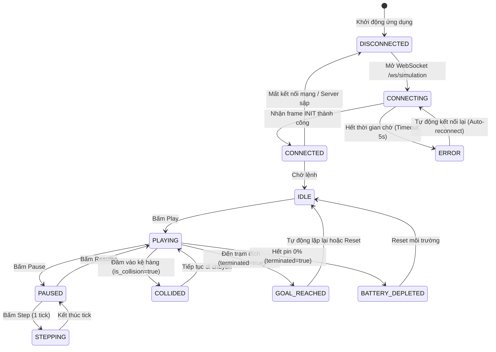

# ROBOPILOT — UI/UX SPECIFICATION & DESIGN SYSTEM
# ĐẶC TẢ GIAO DIỆN NGƯỜI DÙNG & HỆ THỐNG THIẾT KẾ 5 PHÂN HỆ

> **Cơ quan phụ trách:** Tab 6 (@tab_6) — Frontend & UX/UI Designer  
> **Thẩm định:** Tab 7 (@tab_7) — QA Auditor | **Phê duyệt:** Tab 1 (@tab_1) — Orchestrator  
> **Trạng thái:** PROPOSED / PHASE 1 (Sprint 1) | **Ngày ban hành:** 2026-10-30  

---

## 1. NGUYÊN TẮC THIẾT KẾ & TỔNG QUAN HỆ THỐNG (DESIGN PRINCIPLES)

Giao diện RoboPilot được định hướng là **Industrial Cyber-Physical Cockpit** — buồng điều khiển mô phỏng robot kho vận thông minh dành cho Kỹ sư AI/ML, Nhà nghiên cứu Robotics và Quản trị viên Vận hành:
1. **High Visual Density & Zero Fluff:** Tối ưu không gian hiển thị, thông tin khoa học được trình bày súc tích, phản xạ dữ liệu tức thời từ backend.
2. **Deterministic 60 FPS Visual Fidelity:** Hoạt ảnh di chuyển của xe AMR trên bản đồ đạt chuẩn 60 FPS, độ trễ hiển thị (Render Latency) $< 16.6\text{ ms}$.
3. **Ergonomic Operator Experience:** Bố cục 5 phân hệ công thái học, hỗ trợ phím tắt toàn diện, chuyển đổi trạng thái mượt mà không giật lắc.
4. **Dark Mode First:** Giao diện tông màu tối chuyên dụng cho phòng điều khiển công nghiệp, độ tương phản cao, giảm mỏi mắt khi theo dõi huấn luyện hàng giờ.

---

## 2. HỆ THỐNG THIẾT KẾ (DESIGN SYSTEM)

### 2.1. Bảng màu Chuẩn mực (Color Palette)

| Phân loại | Mã Hex | Tên biến CSS | Mục đích sử dụng |
| :--- | :---: | :--- | :--- |
| **Nền chính (Canvas Base)** | `#0B0F17` | `--bg-primary` | Nền toàn bộ ứng dụng, buồng điều khiển |
| **Nền phân hệ (Card/Surface)** | `#111827` | `--bg-surface` | Thẻ phân hệ, bảng điều khiển, modal panel |
| **Nền nổi bật (Surface Hover)**| `#1F2937` | `--bg-elevated` | Trạng thái hover, khung lưới ô trống |
| **Đường viền (Border subtle)** | `#374151` | `--border-subtle`| Phân tách giữa các module, đường kẻ bảng |
| **Điểm nhấn chính (Brand Cyan)** | `#06B6D4` | `--accent-cyan` | Robot AMR, trạng thái Active, nút Action chính |
| **Trạm Đích (Goal Green)** | `#10B981` | `--accent-green`| Vị trí Goal, thành công, pin đầy, hiệu suất tốt |
| **Cảnh báo (Warning Amber)** | `#F59E0B` | `--accent-amber`| Pin yếu ($< 20\%$), trạm sạc Docking, paused |
| **Nguy hiểm / Va chạm (Red)** | `#EF4444` | `--accent-red` | Va chạm kệ hàng, cạn pin ($0\%$), lỗi socket |
| **Văn bản chính (Text High)** | `#F9FAFB` | `--text-primary`| Tiêu đề, số đo đo đạc chính |
| **Văn bản phụ (Text Muted)** | `#9CA3AF` | `--text-muted`  | Nhãn chú thích, đơn vị đo, thông tin phụ |

### 2.2. Phông chữ & Tỷ lệ Không gian (Typography & Spacing)
- **Primary Font:** Inter, `-apple-system`, BlinkMacSystemFont, "Segoe UI", sans-serif.
- **Monospace Font (Telemetry & Code):** "JetBrains Mono", "Fira Code", monospace (dành cho tọa độ, Q-value, log step, frame tick).
- **Thang kích thước chữ:**
  * Title/Header: `1.25rem` (20px), Semi-bold (600).
  * Section/Module: `1.0rem` (16px), Medium (500).
  * Body/Labels: `0.875rem` (14px), Regular (400).
  * Telemetry/Badges: `0.75rem` (12px), Mono Regular/Bold.
- **Grid Layout:** 12-column responsive layout, gap cố định `16px` (1rem).

---

## 3. BỐ CỤC 5 PHÂN HỆ TỔNG THỂ (5-MODULE COCKPIT WIREFRAME)

```
+----------------------------------------------------------------------------------------------------+
|  🤖 ROBOPILOT INDUSTRIAL COCKPIT — v1.0.0 [CONNECTED] [MODEL: D3QN_W10_V3] [MAP: benchmark_hard]  |
+------------------------------------------------------------------+---------------------------------+
|  MODULE 1: SIMULATION ARENA (HTML5 Canvas 2D)                    |  MODULE 3: REAL-TIME TELEMETRY  |
|                                                                  |  - State: (x=4, y=6) Heading: S |
|  [ 0, 0 ] ......................... [ W-1, 0 ]                   |  - Goal:  (x=9, y=9) Dist: 8    |
|  .  [S] [ ] [█] [ ] [ ] [ ] [ ] [ ] [ ]  .                       |  - Step: 14 / 200  | Reward: 8.2|
|  .  [ ] [ ] [█] [ ] [ ] [ ] [ ] [ ] [ ]  .                       |  - Battery: [████████░░] 78%    |
|  .  [ ] [ ] [ ] [ ] [🤖]---> [ ] [ ] [ ]  .                      |  - Collision: NO | Status: OK   |
|  .  [ ] [█] [█] [ ] [·] [ ] [ ] [ ] [ ]  .                       +---------------------------------+
|  .  [ ] [ ] [ ] [ ] [·] [ ] [ ] [ ] [ ]  .                       |  Q-VALUE PROBABILITIES          |
|  .  [ ] [ ] [ ] [ ] [·] [·] [·]---> [G]  .                       |  UP:    [██░░░░░░░░] 1.25       |
|  [ 0, H-1 ] ....................... [ W-1, H-1 ]                 |  DOWN:  [████████░░] 4.82 (BEST)|
|                                                                  |  LEFT:  [█░░░░░░░░░] 0.40       |
|  Viewport: [Zoom: 100%] [Fit Map] [Grid Lines: ON] [Trail: ON]   |  RIGHT: [████░░░░░░] 2.65       |
+------------------------------------------------------------------+---------------------------------+
|  MODULE 2: AGENT CONTROL PANEL                                                                     |
|  [▶ Play] [⏸ Pause] [⏭ Step] [↺ Reset] | Speed: [──────●─────] 20 Ticks/s | Mode: [Manual / Auto] |
|  Map: [benchmark_hard (15x15) ▼] | Model: [D3QN_Warehouse_v2.pt ▼] | Seed: [42]                    |
+----------------------------------------------------------------------------------------------------+
|  MODULE 4: EXPERIMENT & BENCHMARK COMPARISON                     |  MODULE 5: MODEL ARTIFACT HUB   |
|  +--------------------+--------+---------+-----------+---------+ |  Active Model: D3QN_W10_V3      |
|  | Algorithm          | Success| Collide | Avg Steps | Reward  | |  Architecture: Dueling DQN MLP  |
|  +--------------------+--------+---------+-----------+---------+ |  Input Dim: 6 | Hidden: 128x128   |
|  | A* Optimal Baseline| 100.0% |   0.0%  |   18.0    |  +82.0  | |  Trained on: Maps 1, 2 (100k eps|
|  | Tabular Q-Learning |  86.5% |   8.2%  |   23.4    |  +54.2  | |  Checkpoints: [v1] [v2] [v3*]   |
|  | D3QN (Proposed)    |  96.8% |   1.4%  |   19.2    |  +78.6  | |  [Upload Model] [Export JSON]   |
|  +--------------------+--------+---------+-----------+---------+ +---------------------------------+
```

---

## 4. ĐẶC TẢ CHI TIẾT 5 PHÂN HỆ (DETAILED MODULE SPECIFICATIONS)

### 4.1. Phân hệ 1: Simulation Arena (HTML5 Canvas 2D)
- **Công nghệ cốt lõi:** Canvas 2D API chạy trên luồng requestAnimationFrame.
- **Hệ tọa độ & Kích thước:**
  * Đồng bộ 100% với `docs/ENVIRONMENT_SPEC.md`: Gốc tọa độ $(0, 0)$ ở góc trên-bên trái; Trục hoành $x$ sang phải, Trục tung $y$ xuống dưới.
  * Kích thước ô lưới tiêu chuẩn: $S_{\text{cell}} = \min(\lfloor W_{\text{canvas}} / W_{\text{grid}} \rfloor, \lfloor H_{\text{canvas}} / H_{\text{grid}} \rfloor)$, mặc định từ $32\text{px}$ đến $64\text{px}$.
- **Hiển thị các thực thể:**
  1. **Lối đi trống (`EMPTY` - ID: 0):** Tô màu nền `#111827`, kẻ viền lưới nét mảnh `#1F2937`.
  2. **Kệ hàng / Vật cản (`OBSTACLE` - ID: 1):** Khối màu xám kim loại `#374151`, hoa văn vạch chéo bảo hộ công nghiệp (Hazard stripes).
  3. **Trạm xuất phát (`START` - ID: 2):** Vòng tròn đồng tâm viền xanh dương `#3B82F6`, chữ `S` ở giữa.
  4. **Trạm bốc dỡ hàng (`GOAL` - ID: 3):** Khung viền sáng màu xanh lá `#10B981`, hiệu ứng phát sáng nhẹ (glow pulse), chữ `G`.
  5. **Trạm sạc tự động (`CHARGER` - ID: 4):** Biểu tượng tia sét màu vàng `#F59E0B`, chữ `⚡`.
  6. **Xe AMR (Robot Body):** 
     * Thân xe hình tròn đường kính $0.8 \times S_{\text{cell}}$, màu Cyan `#06B6D4`.
     * Mũi tên định hướng (`heading`): Tam giác màu trắng chỉ rõ hướng nhìn: `UP` ($270^\circ$), `DOWN` ($90^\circ$), `LEFT` ($180^\circ$), `RIGHT` ($0^\circ$).
     * Hiệu ứng vệt di chuyển (Breadcrumb Trail): Vẽ chuỗi hạt mờ dần theo các ô robot đã đi qua (tối đa 500 bước), màu xanh mờ `#06B6D440`.
  7. **Hiệu ứng va chạm (Collision Flash):** Khi `is_collision == true`, ô hiện tại chớp viền đỏ rực `#EF4444` trong $200\text{ ms}$ và rung nhẹ (screen shake $\pm 2\text{px}$).

### 4.2. Phân hệ 2: Agent Control Panel
- **Khối nút điều khiển thời gian thực:**
  * `Play / Pause` (Phím tắt: `Space`): Bắt đầu hoặc tạm dừng chu kỳ mô phỏng.
  * `Step` (Phím tắt: `S`): Kích hoạt chạy duy nhất 1 tick (chỉ khả dụng khi đang Pause).
  * `Reset` (Phím tắt: `R`): Đưa môi trường và robot về trạng thái ban đầu (`reset()` env).
- **Thanh trượt tốc độ (Simulation Speed Slider):**
  * Dải điều chỉnh: $1\text{ tick/giây}$ đến $60\text{ ticks/giây}$ (mặc định $20\text{ ticks/s}$).
  * Thể hiện độ trễ tương ứng: $\Delta t = \frac{1000}{\text{Speed}}\text{ ms}$.
- **Hộp chọn tham số (Selectors):**
  * `Map Selector`: Danh sách bản đồ (`benchmark_easy_10x10`, `benchmark_medium_12x12`, `benchmark_hard_15x15`, `custom_upload`).
  * `Model Selector`: Danh sách checkpoint (`A* Planner`, `Q-Learning Tabular`, `D3QN Best Checkpoint`, `Random Agent`).
  * `Mode Toggle`: Chế độ tự hành (Autonomous AI) hoặc Điều khiển bằng tay (Manual Arrow Keys).

### 4.3. Phân hệ 3: Real-Time Telemetry & Q-Values
- **Thẻ trạng thái (Live Telemetry Cards):**
  * Tọa độ hiện tại: `(x, y)` | Hướng: `UP / DOWN / LEFT / RIGHT`.
  * Khoảng cách Manhattan / Euclid tới đích: $D(s, g)$.
  * Điểm thưởng tích lũy (Cumulative Episode Reward): $\sum r_t$.
  * Mức pin xe (Battery Gauge): Thanh bar có màu chuyển từ Xanh ($>50\%$) sang Vàng ($20-50\%$) và Đỏ nguy cấp ($<20\%$).
- **Bảng phân phối Q-Value (Action Probability Bar):**
  * Hiển thị giá trị kỳ vọng $Q(s, a)$ cho cả 4 hành động rời rạc:
    - $\uparrow$ `UP`: Giá trị thực tế kèm thanh đo phần trăm.
    - $\downarrow$ `DOWN`: Giá trị thực tế kèm thanh đo phần trăm.
    - $\leftarrow$ `LEFT`: Giá trị thực tế kèm thanh đo phần trăm.
    - $\rightarrow$ `RIGHT`: Giá trị thực tế kèm thanh đo phần trăm.
  * Làm nổi bật (Highlight viền vàng) hành động có giá trị cực đại $\arg\max_a Q(s, a)$.

### 4.4. Phân hệ 4: Experiment & Benchmark Comparison
- Bảng đối chuẩn khoa học so sánh 3 thuật toán cốt lõi theo tiêu chuẩn khoa học (Mean $\pm$ Std):
  * **Thuật toán A\*:** Chuẩn tối ưu hình học (Oracle Benchmark).
  * **Tabular Q-Learning:** Chuẩn RL cổ điển.
  * **Double Dueling DQN (D3QN):** Thuật toán RL sâu đề xuất.
- Bộ lọc nâng cao: Lọc theo Map, theo Seed (Seed 42, 101, 2024), tải dữ liệu kết quả ra file JSON/CSV.

### 4.5. Phân hệ 5: Model Artifact Hub
- Danh mục Model Artifacts nạp từ Backend:
  * Tên file: `model.pt`, kích thước, ngày huấn luyện.
  * Siêu dữ liệu kiến trúc: Kích thước vector quan sát ($d_{\text{obs}}$), số lớp ẩn ($[128, 128]$), tốc độ học ($\alpha$), hệ số giảm giá ($\gamma$).
  * Nút "Hot Swap": Cho phép thay đổi model đang điều khiển xe ngay trong phiên mô phỏng mà không cần reset kết nối.

---

## 5. CÁC TRẠNG THÁI HIỂN THỊ VÀ XỬ LÝ LỖI (SYSTEM STATES & ERROR HANDLING)



| Tên trạng thái | Biểu hiện giao diện (Visual Feedback) | Khả năng tương tác |
| :--- | :--- | :--- |
| **`DISCONNECTED`** | Huy hiệu xám "Mất kết nối", màn hình che mờ 50% | Khóa mọi nút điều khiển Play/Step |
| **`CONNECTING`** | Huy hiệu vàng xoay tròn "Đang kết nối WebSocket..." | Khóa nút điều khiển, chờ handshake |
| **`PLAYING`** | Huy hiệu xanh lá rực rỡ "LIVE", nút Play đổi thành Pause | Bật toàn bộ điều khiển, cho phép Pause |
| **`PAUSED`** | Huy hiệu vàng "PAUSED", nút Step sáng | Cho phép Step từng bước hoặc Resume |
| **`COLLIDED`** | Viền Canvas nháy đỏ, âm thanh cảnh báo ngắn (tùy chọn) | Tiếp tục chu kỳ theo cấu hình |
| **`GOAL_REACHED`** | Hiệu ứng pháo hoa mờ (Confetti spark), banner "ĐÍCH ĐẾN ĐẠT ĐƯỢC" | Hiện nút Reset hoặc Run Next Episode |
| **`LOW_BATTERY`** | Biểu tượng tia sét nhấp nháy đỏ trên đầu xe AMR | Cảnh báo xe cần tìm trạm sạc Dock |

---

## 6. PHÍM TẮT THAO TÁC NHANH (HOTKEYS CHEAT-SHEET)

| Phím tắt | Thao tác tương ứng | Ghi chú |
| :---: | :--- | :--- |
| **`Space`** | Play / Pause mô phỏng | Phím chuyển trạng thái nhanh nhất |
| **`S`** | Thực thi 1 bước đơn (Step) | Chỉ hoạt động khi đang Pause |
| **`R`** | Khởi động lại Episode (Reset) | Đưa xe về ô Start, nạp pin $100\%$ |
| **`[` / `]`** | Giảm / Tăng tốc độ mô phỏng | Bước nhảy $5\text{ ticks/s}$ |
| **`G`** | Bật / Tắt hiển thị đường lưới (Grid Lines) | Tiện theo dõi tọa độ |
| **`T`** | Bật / Tắt vệt đường đi đã qua (Trail) | Xóa vệt để nhìn bản đồ thoáng hơn |
| **`F`** | Tự động căn chỉnh bản đồ vào khung (Fit to Screen)| Điều chỉnh zoom Canvas theo kích thước map |
